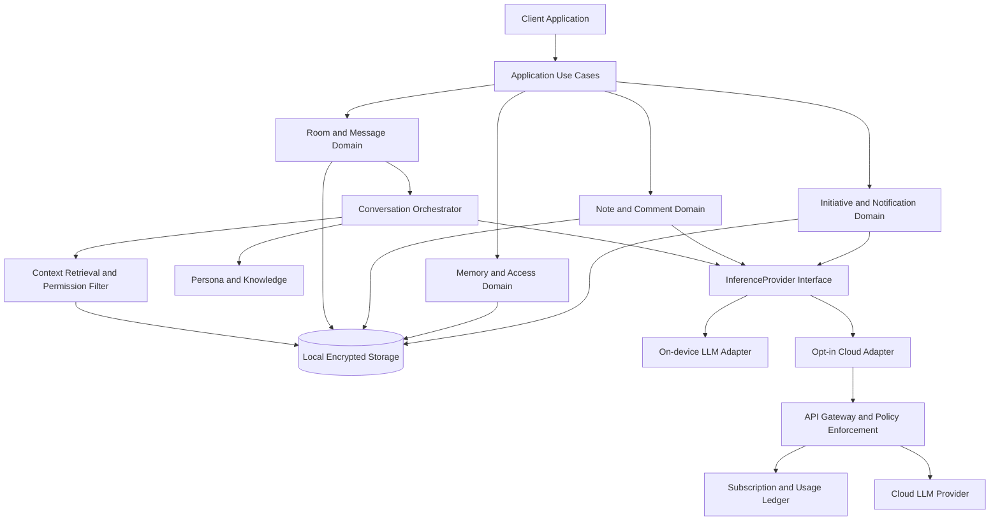

# AGORA — 통합 개발 지시서 v1.0

> **대상:** Claude Code / Codex / AI 개발 오케스트레이터 / 실제 구현 담당자  
> **작성:** 2026-10-14  
> **목적:** 합의된 제품 요구사항과 사용자가 승인한 **기존 Claude 디자인 초안**을 바탕으로, AGORA를 시연용 디자인에서 실제 실행 가능한 AI-Native 앱으로 단계적으로 개발한다.  
> **상태:** 실행 지시서. 기술 선택 중 검증 전인 내용은 가정으로 표시한다.  
> **최초 플랫폼:** Android 우선. iOS·Windows 등 후속 확장을 고려하되 동시 출시를 강제하지 않는다.  
> **공식 제품 언어:** 한국어, 영어.  
> **요구사항 상세 원본:** `AGORA_Integrated_Master_Blueprint_v2.1.md` (이 문서 맨 아래에 원문 전체 첨부).  
> **디자인 원본:** `AGORA_design_draft.zip` (어스름 시안; 실제 프로젝트 자산).  
>
> **최상위 명령:** **새 디자인을 제안하거나 처음부터 새 화면을 그리지 말 것. 기존 디자인 초안을 구현의 시각적·상호작용적 기준으로 삼을 것.** 이미 합의한 제품 경험과 최근 대화 내용을 반영하되, 화면의 브랜드·색·타이포그래피·컴포넌트 문법·사용 흐름을 임의로 바꾸지 않는다. 변경이 필요한 부분은 별도 차이 보고와 승인 후 진행한다.

---

## 0. 실행 전 2분 요약 — 절대 잊지 말아야 할 12개 규칙

1. **AGORA는 토론대회가 아닌 철학자 AI와 자유롭게 대화하는 메신저**다. 음악·날씨·출근·권태·책·잡담 등 모든 일상 이야기를 허용한다.
2. **사용자가 첨부한 `AGORA_design_draft.zip`의 현재 디자인이 시각적 기준선**이다. 이를 무시하고 개발자가 새로운 디자인 시스템, 와이어프레임 또는 다른 채팅 UI로 대체하지 않는다.
3. 채팅은 **여러 개의 독립적인 단톡방**, 전체 광장, 철학자별 개인톡으로 구성된다. 철학자는 일부만 말하거나 침묵할 수 있고, 서로 자연스럽게 대화한다.
4. `@니체`, `@카뮈` 등 **@멘션은 실제 지정·호출**이다. 방 밖 철학자는 이번 대화만 임시 초대하거나 고정 멤버로 추가한다.
5. 논쟁은 가끔 자연스럽게 벌어질 수 있으나 **라운드/심판/발언 6/6/찬반 대결**을 기본 채팅 흐름에 넣지 않는다. 빈도·격렬함 설정은 단계적으로 실제 성능 검증한다.
6. **'일기'가 아닌 '노트'**다. 같은 날짜에 독립 노트를 원하는 만큼 만든다. 날짜는 분류 기준일 뿐 노트의 고유 키가 아니다.
7. 직접 쓴 **나의 노트**, AI가 대화로 만든 **대화 노트**, 철학자가 자신의 관점으로 쓴 **철학자의 사유 노트**를 구분한다. 사용자 감상평·댓글·답글은 해당 `note_id`에 연결한다.
8. **'댓글 부탁하기'는 수동 보조 기능일 뿐 유일한 경로가 아니다.** 철학자는 허용된 노트에 나중에 스스로 댓글을 남기고, 개인톡이나 단톡방에서 먼저 말을 걸거나 새로운 화제를 제시할 수 있다.
9. 무료는 **온디바이스 로컬 AI로도 온전한 경험**을 제공한다. 사전 생성→예약 전달→게시 직전 맥락 재검증 방식을 적극 허용한다. 유료 클라우드 AI는 선택형 고급 기능이다.
10. **철학자를 추가할 때 앱 기능 코드를 수정하지 않는 등록형 구조**로 시작한다. 초기에 니체·쇼펜하우어 2명 검증 → 카뮈·시오랑·소크라테스·마르쿠스 아우렐리우스까지 6명 베타 → 추가 지식 팩 확장.
11. **한국어·영어**, UI 언어와 대화 언어의 별도 관리, **시스템/라이트/다크** 설정을 처음부터 구현한다. 언어·테마 전환은 노트·채팅 기록을 지워서는 안 된다.
12. **AI-Native는 제품과 개발 과정 모두에 적용**한다. AI 코딩 에이전트가 구현·테스트·리뷰를 수행하지만, 품질·보안·디자인·배포의 최종 승인자는 사용자다. 테스트하지 않은 것을 완료했다고 주장하지 않는다.

---

## 1. 입력 자료와 우선순위 — 소스 오브 트루스

### 1.1 필수 입력 두 가지

**A. `AGORA_design_draft.zip` — 시각 디자인 및 UI 동작의 기준**

업로드된 최신 ZIP을 실제로 조사한 구조:

```text
AGORA_design_draft/
  README.md
  canvas/project/
    canvas.json               # 29개 보드 순서·제목·배치
    Main.dc.html              # 전체 화면/사용 흐름의 단일 메인 보드
    Map.dc.html               # 화면·기능 지도
    Grammar.dc.html           # 디자인·대화 표현 문법
    Plaza.dc.html / Mention.dc.html / Invite.dc.html
    Together.dc.html / Debate.dc.html / Reach.dc.html
    NewRoom.dc.html / NewRoom-Vibe.dc.html / RoomInfo.dc.html
    People.dc.html / Profile.dc.html / Settings.dc.html
    Models.dc.html / Memory.dc.html
    Journal.dc.html / Compose.dc.html / Entry.dc.html
    Entry-Comments.dc.html / Entry-Plan.dc.html / Entry-Access.dc.html
    Notes.dc.html / Note.dc.html
    Welcome.dc.html / Setup.dc.html / Plus.dc.html / Consent.dc.html
  assets/
    agora.css                # 기존 시안의 컬러·폰트·컴포넌트 토큰
    js/01_data.js           # 철학자·한국어/영어 문자열
    js/02_seed.js           # 채팅·노트·예약 데이터 샘플
    js/03_engine.js         # 사전 작성된 답변으로 동작하는 시연용 엔진
    js/04_component.js      # UI 상태·상호작용·이벤트 흐름
    portraits/              # 6명 초상 이미지; 라이선스 확인 필요
  docs/
    AGORA_Integrated_Master_Blueprint_v2.1.md
```

**중요:** `.dc.html`, `<x-dc>`, `support.js`, `/_blob/...`는 Claude 디자인 캔버스 전용 표현이다. **이 파일이 곧 배포 가능한 Android 코드라는 뜻이 아니다.** 새 앱 프로젝트로 옮기되, 시각과 인터랙션을 재현해야 한다. `03_engine.js`의 키워드 분류·사전 문장 선택을 실제 생성형 AI 엔진으로 오인해서는 안 된다. `02_seed.js`는 샘플 데이터이지 영구 저장소가 아니다.

**B. `AGORA_Integrated_Master_Blueprint_v2.1.md` — 제품·데이터·보안·AI 요구사항 기준**

이 지시서의 마지막 부록에 원문 전체를 포함했다. 단톡방, 멘션, 노트 ID, 댓글 권한, 선제 메시지, 프라이버시, 무료/유료, AI 평가 수용 테스트를 모두 따른다.

### 1.2 새로 확정된 내용과 충돌 해결

우선순위는 다음과 같다.

1. **본 문서 0~25장의 명시적 최근 확정 요구사항**: 특히 *기존 디자인 보존*과 *철학자 등록형 확장*.
2. **첨부 v2.1 제품 설계**: 기능·안전·데이터·우선순위의 상세 기준.
3. **기존 디자인 ZIP**: 시각 스타일, 화면 구조, 사용 동선 및 UI 마이크로인터랙션의 기준.
4. 플랫폼 공식 문서·실기기 테스트 결과: 불가능하거나 불안전한 구현은 정직하게 알리고 대안과 차이점을 승인받는다.

예: 기존 v2.1은 시각 디자인을 지정하지 않았으나, **이제는 디자인 초안이 생겼으므로 개발 시 반드시 그 디자인을 기반으로 한다.** 설계서의 UI 비지정 문구는 '기존 시안을 바꿔도 된다'는 뜻이 아니다. 반대로 디자인 시연 코드의 예시 데이터·완성된 것처럼 보이는 버튼은 기능 구현의 증거가 아니며 v2.1의 실제 동작 조건을 충족해야 한다.

충돌 발견 시 `docs/decisions/`의 ADR에 **원문 출처 → 충돌 지점 → 제안 대안 → 영향 → 승인 필요 여부**를 남긴다. UX 변경을 임의로 밀어붙이지 않는다.

---

## 2. 디자인 이식 계약 — 변경하지 말고 구현할 것

### 2.1 디자이너가 아닌 구현자의 자세

- 현 디자인 콘셉트 **'어스름'**을 현재 승인 기준선으로 취급한다.
- 현재 **정보 구조, 탐색 흐름, 채팅 말풍선, 초상·이름 식별, 상태 표시, 노트 카드·편집·댓글, 아이콘 스타일, 모달/시트, 언어·테마 토글**을 우선 그대로 이식한다.
- `assets/agora.css`의 실제 토큰, `Grammar.dc.html`, `Main.dc.html` 및 보드 스크린샷을 먼저 분석한다. **기존 CSS에서 디자인 토큰과 컴포넌트 계약을 추출하는 작업**을 수행한다.
- 현재 시안의 라이트/다크 팔레트와 대비를 유지한다. 예: 라이트 배경 `#F5F4F9`, 카드 `#FFFFFF`, 다크 배경 `#131315`, 카드 `#1C1C1F`, 발화/상태의 호박색 등은 원본 CSS가 최종 근거다. **새 팔레트·새 브랜딩으로 교체 금지.**
- 시안에 사용된 Gothic A1/Gowun Batang 계열의 타이포그래피 의도를 유지한다. 실제 앱에 폰트를 배포할 경우 서체 라이선스를 확인하고 플랫폼 대체 폰트로 인한 시각 차이를 기록한다.
- 철학자별 이름 색상과 초상 표현, 라이트·다크 간 일관성을 유지한다. 초상 이미지 가운데 권리 확인이 필요한 항목은 라이선스 검토 전 **출시 자산으로 단정하여 번들하지 않는다**. 허가된 대체 이미지를 적용해야 할 경우 승인받는다.
- 현재 412×915 시안은 **시각 비교 기준 이미지**이지 실제 UI의 고정 크기 아니다. 화면 크기·안전 영역·소프트 키보드·대체 글꼴·화면 확대에 대응하도록 반응형 구현한다.
- 존재하지 않는 새 페이지가 기능상 꼭 필요하면 기존 컴포넌트 문법을 그대로 재사용한 **최소 추가 화면**을 제시하고 승인 후 구현한다.
- 시연에 쓰인 `ai badge` 등을 삭제·이동하거나 브랜딩을 '더 예쁘게' 바꾸려는 판단은 이번 개발자의 업무가 아니다.

### 2.2 필수 디자인 화면 대응표

| 기존 보드/소스 | 실제 앱에서 담당할 기능 | 참고 |
|---|---|---|
| `Main.dc.html` | 앱 전체 라우팅과 주요 UI 계약 | 하나의 거대한 배포 파일로 유지할 필요 없음; 화면별 컴포넌트로 분해 가능 |
| `Plaza.dc.html`, `Together.dc.html` | 단톡방·자율 대화·일시정지·기존 말풍선 | 기본 경험. 토론 대회 UI로 회귀 금지 |
| `Mention.dc.html`, `Invite.dc.html` | `@` 자동완성, 철학자 ID 바인딩, 임시/고정 초대 | 사용자 멘션 우선 |
| `Debate.dc.html` | 선택적으로 생기는 자연스러운 논쟁, 톤 완화 | P1 정교 제어는 시각 표현과 실제 성능 구별 |
| `Reach.dc.html` | 먼저 건넨 메시지, '왜 왔나요?' | 실제 예약/맥락 검증 연결 필요 |
| `NewRoom.dc.html`, `NewRoom-Vibe.dc.html`, `RoomInfo.dc.html` | 여러 방 만들기, 구성원·분위기·알림 | 방별 상태·기억·설정 격리 |
| `People.dc.html`, `Profile.dc.html` | 철학자 탐색·프로필·개인톡·노트 연결 | 등록형 확장 시스템과 연계 |
| `Journal.dc.html`, `Compose.dc.html` | **나의 노트 목록**과 새 노트 작성 | 파일명 `Journal`은 레거시 내부 명칭. 사용자 UI에는 일기 금지 |
| `Entry.dc.html`, `Entry-Comments.dc.html` | 대화 노트·사용자 감상평·철학자 댓글·답글 | `note_id`에 연결 |
| `Entry-Plan.dc.html`, `Entry-Access.dc.html` | 자동 댓글 예약과 노트별 열람 권한 | '지금 받기' 시연을 실제 예약으로 대체 |
| `Notes.dc.html`, `Note.dc.html` | **철학자의 사유 노트**·사용자 댓글·철학자 답글 | 실제 AI 생성·출처 추적 |
| `Settings.dc.html`, `Models.dc.html`, `Memory.dc.html` | 언어/테마/로컬 모델/메모리/알림/권한 | 상태 영구 보존 |
| `Welcome.dc.html`, `Setup.dc.html`, `Consent.dc.html`, `Plus.dc.html` | 온보딩·모델 배포·동의·구독 | 실제 플랫폼 권한·결제·오류로 연결 |
| `Map.dc.html`, `Grammar.dc.html` | 개발 시 화면 및 UI 컴포넌트 계약 참조 | 배포 화면 필수 아님 |

### 2.3 시각적 회귀 방지 절차

1. ZIP의 원본 시안을 **수정 없는 읽기 전용 참고 자료**로 저장한다.
2. 주요 화면의 라이트/다크 기준 스크린샷을 원본 또는 제공된 렌더링에서 얻는다. 원본 캔버스에 접근 불가하면 사용자가 승인한 기존 스크린샷·원본 CSS·화면 동작을 비교 근거로 명시한다. 임의 생성한 가짜 기준 이미지를 '원본'으로 주장하지 않는다.
3. 플랫폼 이식 화면에 대해 상태별 스크린샷을 만들고 **레이아웃·정보 우선순위·텍스트 계층·색·여백·컴포넌트 흐름**을 비교한다.
4. 차이가 생긴 경우 표로 보고한다: `화면 / 기존 동작·모양 / 신규 동작·모양 / 원인 / 필수 변경 여부 / 승인 상태`.
5. 기능 구현을 이유로 기존 시안 전체를 새로 그리거나 자체 디자인 시스템으로 갈아엎지 않는다.
6. OS별 네이티브 제약 때문에 변경이 필수면 **사용자 승인 이후에만** 처리한다.

**금지 행동 예시:** 'Claude 시안은 HTML이라 재사용이 불가능하니 Material 기본 테마로 전부 다시 만들겠습니다.' → 금지. **가능한 행동:** UI 구조·색·타이포그래피·상호작용을 이식하면서 플랫폼에 맞는 컴포넌트로 재구현.

---

## 3. 제품 정의 및 사용자가 실제로 경험할 핵심 흐름

**한 문장:** AGORA는 여러 철학자 AI가 모인 **살아 있는 메신저**이자, 사용자·철학자가 노트와 댓글을 남기고 시간이 지난 후에도 대화를 이어가는 **개인 사유 공간**이다.

### 흐름 A: 별 의미 없어 보이는 일상 이야기

사용자: `빗속의 출근길에서 오랜만에 유재하를 만났다. 오랜만에 듣는 그의 목소리가 더 깊고 묵직하다.`

- 음악가를 직접 만났다는 뜻보다 **음악을 다시 들었다는 비유**로 해석할 수 있어야 한다.
- 참여 인물 중 상황에 맞는 **1~3명 정도만 자연스럽게 응답**하고 다른 사람은 침묵해도 된다.
- 일상·감상의 결을 보존하며 반드시 철학 개념을 교과서식으로 강의하지 않는다.
- 한 철학자가 다른 철학자의 실제 최신 메시지에 맞장구/반박/농담을 할 수 있다.
- 유재하의 인물 정보 등 문화 지식이 불확실한 작은 로컬 모델은 근거 없는 세부 사실을 지어내지 않는다.

### 흐름 B: 사용자 주도 자유로운 단톡방

- 사용자는 `철학자들의 광장`, `허무주의자들의 방`, `일상의 철학` 같은 서로 다른 그룹방을 **동시에 여러 개** 만들 수 있다.
- 방마다 이름, 참여 철학자, 채팅 기록, 자율 대화, 논쟁 성향, 언어, 알림이 분리된다.
- 철학자들의 답변은 순서가 정해진 라운드가 아닌 **실제 채팅처럼 순차적으로 등장**한다.
- 사용자가 `@니체`를 입력해 제안 목록에서 선택하면 해당 철학자의 **고유 ID**를 저장한다. 방 밖 인물이면 임시/고정 초대 선택. 멘션자는 우선 답변하고 다른 인물은 자연스럽게 참여할 수 있다.
- 사용자가 논쟁 중 새 메시지를 보내거나 '다른 얘기 하자', '좀 더 부드럽게'를 선택하면 기존 생성 대기열을 취소·재평가한다.

### 흐름 C: 글과 댓글이 이어지는 노트

- 사용자는 같은 날 오전·점심·저녁에 **서로 다른 새 노트**를 만든다. `display_local_date`는 그룹핑에만 쓰고 `note_id`는 고유하다.
- AI는 선택한 대화 메시지를 요약해 **별도의 새 대화 노트**를 만든다. 메시지 원문을 AI가 마음대로 수정하지 않는다.
- 사용자는 노트에 **자신의 감상평**을 원문과 별도로 쓰고 수정할 수 있다.
- 허용된 철학자는 사용자의 노트에 댓글/답글을 달고, 사용자도 철학자 노트에 댓글을 단다.
- 카뮈 같은 철학자는 대화에서 떠오른 주제로 자신의 **독립된 사유 노트**를 남긴다. 실제 역사적 인물의 비공개 일기를 재현했다고 주장하지 않는다.

### 흐름 D: AI가 나중에 먼저 말을 걸기

- 사용자 허용을 받고, 앱 사용 중 기기에서 **댓글/개인톡/단톡방 화제/철학자 사유 노트 후보를 미리 생성**한다.
- 몇 시간 뒤 댓글 또는 메시지로 도착할 수 있다. 사용자에게는 메신저처럼 자연스럽게 보이되 **AI 시뮬레이션임을 숨기지 않는다**.
- 공개 직전 `note_id`, `note_revision`, `context_revision`, 접근 권한, 이미 답변한 질문, 중복성, 알림 설정, 조용한 시간을 검사한다.
- 노트 삭제·비공개 전환·메시지 변경·거부 시 예약을 취소한다. 맞지 않는 후보를 억지로 보여주지 않는다.
- 앱이 실행 중이지 않다고 로컬 AI가 항상 다시 살아나 새 글을 생성한다고 약속하지 않는다. 운영체제 예약·배터리 제한을 따른다.
- Plus에서는 명시적으로 동의한 경우 서버에서 필요 시점에 최신 맥락으로 생성하는 옵션을 제공할 수 있다.

### 흐름 E: 가끔 깊어지는 논쟁

- 철학자가 서로 다른 관점을 표명하면 자연스럽게 의견 충돌이 생길 수 있다.
- 빈도 `off / rare / normal / frequent`, 강도 `gentle / balanced / rigorous`는 방별 설정으로 **사용자가 원할 경우** 활용한다.
- '격렬함'은 더 정교한 반론·논증의 지속성이지 욕설·공격성이 아니다.
- **정교한 제어는 P1**: 소형 로컬 LLM에서 실제 설정 준수도를 검증해 제공하며, 준비되지 않았을 땐 동작을 속여서 완성했다고 주장하지 않는다.
- 어떤 대화에서도 '토론 라운드', '찬성/반대팀', '심판', '한 라운드 더'를 필수 UI로 되돌리지 않는다.

---

## 4. 철학자 추가: Philosopher Registry는 처음부터 필요하다 (최근 확정)

### 4.1 목표

**새 철학자 추가는 앱 기능 코드 패치가 아니라 검증된 데이터 팩 등록**으로 끝나야 한다. 단, UI에서 신규 인물 정보를 표시하는 범용 컴포넌트는 초기부터 갖춘다.

- `Philosopher Engine`: 공통 대화 생성 인터페이스.
- `Philosopher Registry`: 철학자 ID/별칭/로케일/버전/배포·활성화 상태 검색.
- `Philosopher Persona Pack`: 말투·질문 스타일·논변 선호·자율성·안전 정책.
- `Philosopher Knowledge Pack`: 공신력 있는 저작·핵심 개념·시대·관계·출처 메타데이터.
- `Conversation Orchestrator`: 방별 참여·멘션·발언 선택·취소.

**중요:** 인물이 늘어도 모델 하나를 공유한다. 별도 모델 가중치가 철학자 수만큼 필요하지 않다. 런타임에서 `philosopher_id`로 읽어 오며, 지식 팩 다운로드는 후속 확장 옵션이다.

### 4.2 초기 로드맵

| 단계 | 인물 | 상태 |
|---|---|---|
| 기술 검증 | 니체(`nietzsche`), 쇼펜하우어(`schopenhauer`) | 첫 두 명으로 모델 품질·턴 교환 검증 |
| 첫 베타 확장 | 카뮈(`camus`), 시오랑(`cioran`), 소크라테스(`socrates`), 마르쿠스 아우렐리우스(`marcus_aurelius`) | 6명 완성 목표 |
| 이후 | 스피노자, 키르케고르, 에피쿠로스 등 | 철학자 라이브러리·선택 팩 검토 |

**주의:** 시안의 `01_data.js`는 임시 단축 ID(`ni`, `sh` 등)를 쓴다. 실제 앱에는 **안정적인 고유 ID**를 도입하고 `ni→nietzsche`, `sh→schopenhauer`, `ca→camus`, `ci→cioran`, `so→socrates`, `au→marcus_aurelius` 같은 일회성 매핑과 마이그레이션 테이블을 둔다. 이 매핑 때문에 UI나 표시 이름이 달라져서는 안 된다.

### 4.3 팩 계약 예시(개념)

```yaml
schema_version: 1
id: nietzsche
pack_version: "1.0.0"
name:
  ko: "프리드리히 니체"
  en: "Friedrich Nietzsche"
aliases:
  ko: ["니체"]
  en: ["Nietzsche"]
persona:
  dialogue_style_ko: "일상에서는 자연스럽고 상황에 따라 도전적으로 질문"
  dialogue_style_en: "Natural in casual chat, probing when appropriate"
  ask_question_tendency: medium
  default_length_profile: adaptive
philosophical_concepts: ["value_creation", "self_overcoming", "eternal_recurrence"]
relations:
  - philosopher_id: schopenhauer
    relation_type: intellectual_influence_and_critique
knowledge_refs: []  # 출처 식별자·라이선스 검증 자료로 별도 관리
portrait_asset_id: nietzsche_portrait
locales: [ko, en]
status: active
```

**금지:** 철학자별 말투를 UI 컴포넌트나 방 코드의 거대한 `if/else`로 하드코딩. 철학 원전의 실제 인용문과 AI 생성문을 혼합 표기. 캐릭터 지식 팩이 다른 방의 개인 기록을 무단 읽는 구조.

### 4.4 추가 테스트

새로운 `philosopher_id`/팩을 하나 등록하는 통합 테스트를 만든다. **개인톡 생성, 새 방에서 멤버 선택, `@` 자동완성, 임시 초대, 노트 댓글, 철학자 자신의 노트, 선제 메시지 대상, 한국어/영어, 삭제·비활성화**까지 기존 공통 엔진으로 작동해야 한다. 신규 철학자 추가만으로 공통 메시지·노트·댓글 기능 파일 수정이 필요하다면 구조를 재검토한다.

---

## 5. 시스템 아키텍처 및 기술 선택

### 5.1 플랫폼 결정을 무작정 고정하지 않는다

- **Android 우선** 실제 설치·실행 가능한 앱(`.apk` 테스트, Play용 `.aab` 릴리스 파이프라인)을 개발한다.
- 후보 1순위: **Kotlin + Compose Multiplatform**을 포함한 공유 UI/도메인. 후보 2: Android Native Kotlin + Compose에 공유 도메인 분리. 다른 스택은 반드시 이식·로컬 AI 호환성과 디자인 충실도에 근거해 제안한다.
- **Sprint 0에서 실기기 LLM 런타임·모델 배포·UI 이식 빌드**를 검증하고 ADR로 선택을 확정한다. 선호만으로 지원 OS, 모델 용량, 메모리 하한을 선언하지 않는다.
- iOS에는 Mac/Xcode 빌드 환경과 실제 기기 성능 시험이 필요하다. Windows/macOS까지 한 번에 완성하려 하지 않는다.

### 5.2 모듈 경계

```text
app-ui/                   # 기존 디자인 기반 화면(플랫폼별 표현)
app-domain/               # 공통 엔티티·유스케이스·권한
  rooms/                  # 여러 단톡방·개인톡·메시지
  mentions/               # 철학자 ID 바인딩·초대
  notes/                  # 사용자/대화/철학자 노트·감상평
  comments/               # 댓글·대댓글
  philosophers/           # Registry·Persona·Knowledge Pack
  orchestration/          # 발언 선택·자율 대화·예산·중단
  proactive/              # 예약 계획·사전 생성·검증·전달
  memory/                 # 허가된 출처 검색·요약·망각
  entitlements/           # Free/Plus 정책·크레딧
app-inference/
  inference-api/          # 모델 독립 실행 계약
  local-llm/              # 모바일 로컬 런타임 어댑터
  cloud-llm/              # 선택형 서버 호출 어댑터
app-persistence/          # Room/SQLite 등, 암호화·마이그레이션
backend/                  # Plus API 프록시/검증/크레딧/잡(후속)
qa/                       # 모델 평가·시각 회귀·E2E·실기기 측정
resources/                # i18n·캐릭터 팩·권리 확인 자산
legacy-design-reference/  # 기존 ZIP 자산의 읽기 전용 참조
```

이 폴더 이름은 **권장 논리 구조**다. 선택 프레임워크에 맞춘 합리적 변형은 ADR로 기록할 수 있다. 가장 중요한 불변식은 **UI ≠ 대화 엔진 ≠ 권한 검사 ≠ 노트 저장 ≠ 모델 호출**의 분리다.

### 5.3 생성 API 추상화

공통 `InferenceProvider`는 `generate(context, persona, task, output_budget)`의 스트리밍·취소·오류를 제공한다. `provider_type=LOCAL | CLOUD`를 구분하고 AI가 사용자 권한·과금 상태를 결정하지 못하게 한다. 채팅, 대화 노트, 댓글, 철학자 노트, 선제 메시지에서 같은 인터페이스를 사용한다.

로컬 런타임 후보는 `llama.cpp` 또는 지원 환경에 맞는 모바일 추론 엔진을 검증한다. 모델·양자화는 2개 이상 후보를 실제 기기에서 시험해 결정한다. 배포 라이선스·메모리·온디바이스 처리량·한영 품질·일기 품질·장문 토론을 비교한다. **시연 문장 배열을 실제 AI로 대체했다는 사실을 검증할 수 있어야 한다.**

### 5.4 요청 파이프라인

```text
사용자 입력(메시지·노트·멘션)
 -> 데이터 커밋 + 권한 검증 + 현재 대화/노트 리비전 확보
 -> 메시지 유형·상황 분류(코드/로컬 LLM)
 -> 발언할 철학자 후보 선택(방 멤버십/@멘션/관련성/최근 발언)
 -> 허가된 기록만 추출(프라이버시 스코프 검증)
 -> 캐릭터 팩+관련 철학 지식 주입
 -> LOCAL(무료) 또는 승인된 CLOUD(Plus) 모델 실행
 -> 스트리밍/취소/완성 메시지 커밋
 -> 발언 예산·중복·사용자 개입 확인
 -> 이어 말하기 또는 대기
 -> 허용 시 노트/댓글/선제 후보 작업 큐로 전달
```

**실제 앱이 사용자와 철학자의 대화처럼 느껴지는 것이 성공 조건이다.** 조율기 로직이 보인다고 해서 UI에 'N번째 라운드'를 노출하지 않는다.

---

## 6. 메신저·멘션·논쟁 실행 상세

### 6.1 실행 상태(권장)

`IDLE → MESSAGE_SAVED → CONTEXT_READY → SPEAKER_SELECTED → GENERATING → MESSAGE_SAVED → NEXT_DECISION → IDLE`.

예외/중단: `PAUSED / CANCELLED / MODEL_UNAVAILABLE / GENERATION_FAILED / BUDGET_REACHED`.

각 작업은 `room_id`, `generation_id`, `context_revision`, `selected_philosopher_id`, `cancel_token`, `provider_id`, `output_budget`를 갖는다. 방을 바꿔도 다른 방에 응답이 저장되지 않도록 한다.

### 6.2 필수 규칙

- 사용자 `@멘션`은 스케줄된 AI 발언보다 우선한다.
- 동일한 질문에 모든 철학자가 답하지 않는다. 관련 인물 일부·기존 언급 대상·침묵 가능성을 포함한다.
- 화제에 반응해 적절한 발언 길이를 선택한다. 무료라고 인위적으로 단답만 하게 만들어 품질을 훼손하지 않는다.
- 지식이 불확실하면 사실 확인 없이 단정하거나 출처를 꾸며내지 않는다.
- 철학자 간 발언은 실제 앞선 메시지와 맥락적으로 연결한다.
- 사용자가 중단·새 화제·완화 메시지를 보내면 오래된 후속 생성 대기열은 폐기하거나 새로운 리비전에서 다시 생성한다.
- 자동 논쟁은 **사용자가 정한 예산 범위**에서만 이어간다. 모델 반복/비용/배터리 예산으로 종료한다.
- AI끼리 멘션을 무한 반복하며 사용자에게 과도한 알림을 보내지 않는다.

---

## 7. 노트는 항상 N개: 데이터·댓글·권한 불변식

### 7.1 단위 정의

- `USER_AUTHORED`: 사용자 직접 작성 노트.
- `CONVERSATION_SUMMARY`: 특정 방/개인톡의 선택 메시지 범위를 생성 AI가 요약한 별도 노트.
- `PHILOSOPHER_REFLECTION`: 철학자가 자신의 사상으로 작성한 독립적 사유 노트.
- `UserReflection`: 사용자가 특정 노트에 추가하는 독립적인 감상평/추가 생각.
- `Comment`: 사용자/철학자의 댓글. `note_id`와 `parent_comment_id` 참조.
- `NoteRevision`: 내용 변경 이력. `note_id`는 수정으로 변하지 않는다.

**절대 금지:** `UNIQUE(user_id, local_date)` / `UNIQUE(date)` 같은 '하루 노트 1개' 제약. 채팅이나 노트를 기계적으로 하루 하나로 합치기. 언어 전환 시 노트/메시지 다시 seed하기. AI가 사용자 노트 원문을 임의 수정하기.

### 7.2 최소 관계(제안)

```text
Philosopher(1)  -> PersonaPack(N), KnowledgePack(N)
Room(1)         -> RoomMember(N), Message(N)
Message(1)      -> Mention(N), MessageSourceRef(N)
Note(1)         -> NoteRevision(N), UserReflection(N), Comment(N)
Note(N)         -> SourceRef(N) -> Message/Room/Note/Comment
Comment(1)      -> child Comment(N)
Note/Room/Comment -> ProactivePlan(N)
ProactivePlan(1) -> ScheduledDelivery(0..N)
```

보관할 중요한 필드:
`id`, `author_type`, `author_id`, `type`, `body`, `created_at_utc`, `updated_at_utc`, `display_local_date`, `creation_timezone`, `locale`, `note_revision`, `privacy_scope`, `source_refs`, `generation_provider`, `status`, `idempotency_key`.

### 7.3 권한 계약

- 노트 기본 `PRIVATE`; 사용자가 `SELECTED_PHILOSOPHERS` 또는 `ALL_MY_PHILOSOPHERS`를 명시적으로 허용한 범위에서만 댓글·기억에 사용한다.
- 나의 노트 내용이 자동으로 다른 방이나 다른 철학자 개인톡에 퍼져서는 안 된다.
- **클라우드 전송 동의는 철학자 열람 동의와 별도**이다. 데이터 목적·범위·전송을 사용자가 이해하고 선택한다.
- `@멘션`으로 특정 인물을 초대하더라도 과거 다른 방의 민감 정보가 자동 유출되지 않는다.
- 원문 삭제·읽기 권한 취소 시 관련 예약 작업의 유효성을 즉시 취소한다.

### 7.4 마이그레이션 주의

시안 내부 또는 과거 코드의 `Journal`, `journalId`, `journals`, `Entry` 등의 식별자는 **내부 레거시 용어일 수 있다.** UI 사용자 문구는 반드시 **노트**로 통일한다. 실제 영속 계층에서는 `Note`/`note_id` 중심으로 새 구조를 만들고 필요 시 기존 예시 데이터만 마이그레이션한다. 변경 과정에서 같은 날 작성한 별도 기록을 하나로 합치지 않는다.

---

## 8. 자율 행동 엔진 (Proactive/Initiative) — 핵심 기능

### 8.1 같은 엔진에서 관리할 행동 유형

| 코드 | 사용자 경험 | 기본 우선순위 |
|---|---|---|
| `COMMENT_ON_USER_NOTE` | 허용된 내 노트에 철학자가 몇 시간 뒤 댓글 | P0 |
| `PROACTIVE_DM` | 카뮈·니체 등이 먼저 1:1 메시지 | P0 |
| `PHILOSOPHER_NOTE` | 철학자가 대화 이후 자신만의 사유 노트 작성 | P0 기본·고급 P1 |
| `CONTINUE_ROOM_CONVERSATION` | 철학자들이 기존 화제에 대해 나중에 다시 대화 | P1 정교 자동화, P0 기본 이어 말하기 |
| `START_NEW_ROOM_TOPIC` | 철학자 한 명이 허용된 맥락에서 새 화제 제안 | 단계별 검증 후 P1 |

수동 버튼(`댓글 부탁하기`, `사유 노트 부탁하기`)은 유지하되 **그 버튼만 눌러야 행동하는 앱으로 만들지 않는다**.

### 8.2 무료 경로 — 사전 생성·예약·노출

```text
노트 저장/대화 완료/감상평 추가
 -> 접근 권한·자동 동작 설정 확인
 -> 의미 있는 후보가 있는지 결정(0개 가능)
 -> 로컬 LLM이 앱 사용 중 후보 텍스트 생성
 -> ProactivePlan과 메시지 본문을 로컬에 안전 저장
 -> 노출 예정 시각 설정 + OS 제약 내에서 예약
 -> 예정 시점/다음 앱 실행 시 권한·맥락·중복 재검증
 -> 유효하면 실제 댓글/메시지 엔티티로 커밋
 -> 설정에 따라 로컬 알림 및 화면 갱신
```

사용자에게는 **몇 시간 뒤 철학자가 자연스럽게 말을 걸어온 느낌**을 주면 된다. 특정 시각에 새 토큰이 생성되어야 한다는 요구는 없다. 오프라인에서도 이용 가능해야 하므로 로컬 예약 후보가 중요하다. **이미 예약된 댓글이나 알림을 단순 화면 시연용 '지금 받기' 버튼으로만 공개하는 구현은 미완료다.**

### 8.3 취소·갱신·실패 대응

- 예약은 `target_note_id`, `target_note_revision`, `room_id?`, `context_revision`, `recipient_philosopher_id`, `permission_snapshot_hash`, `scheduled_at`, `expires_at`, `generation_provenance`, `status`에 연결한다.
- 게시 직전 우선순위: (a) 노트 삭제 여부 → (b) 접근 권한 → (c) 사용자의 현재 동의/조용한 시간/인물별 설정 → (d) 중복/이미 답변됨 → (e) 맥락 수정/버전 변화 → (f) 제한·예산.
- 미유효 후보는 `CANCELLED_STALE` 또는 `CANCELLED_PERMISSION`으로 마킹하고 알림·메시지를 발송하지 않는다.
- 재생성은 배터리/서버 비용을 관리하며 가능할 때 새 계획으로 작성한다. 원래 생성 후보를 무조건 폐기·무한 재생성하지 않는다.
- 앱이 강제 종료되거나 재부팅되더라도 **예약 메타데이터는 저장돼야** 한다. OS의 정확한 시각 보장은 과장하지 않는다.
- 수신 동의 거부/휴식/조용한 시간/차단을 실시간 반영한다. 과도한 연락·감정적 의존을 유도하지 않는다.

### 8.4 유료 경로 — 선택형 클라우드 생성

- 사용자가 허용한 기록만 서버로 전달; API 키·구독 검증·크레딧 관리는 서버 처리.
- 서버가 적정 시점에 생성 후 안전하게 푸시할 수 있지만 모든 메시지를 클라우드로 강제 전송하지 않는다.
- 클라우드 비용 상한, 토큰 예산, 동시 실행 제한, 취소/중복 방지를 적용한다.
- Plus가 끝나도 무료 로컬 채팅·노트·기존 기록에 접근할 수 있어야 한다.

---

## 9. AI 응답의 품질·검증

### 9.1 철학자 개성 평가

- 카뮈/시오랑/니체/쇼펜하우어 등은 **철학적 사상과 일상적 대화 습관에서 구별**되어야 한다.
- 평범한 음악 감상에 모두가 똑같이 “오늘도 힘내세요”라고 답하거나 모두가 철학 개념을 강의하면 실패.
- 누군가의 주장에 반박할 때 역사적 관계와 철학적 차이를 왜곡하지 않음. 실제 인용/의역/창작 대사를 구별.
- 사용자 감정에 대해 의학적/심리적 진단을 임의로 확정하지 않는다.

### 9.2 평가 데이터셋

필수 평가 표현: `빗속의 출근길에서 오랜만에 유재하를 만났다. 오랜만에 듣는 그의 목소리가 더 깊고 묵직하다.`

추가 평가 범주: 인사 / 점심 메뉴 / 직장 스트레스 / 무의미한 일상 / 성취·노력 / 음악·책 감상 / 감정 표현 / 경미한 농담 / 주제 바꾸기 / 논쟁 완화 / `@` 호출 / 멀티룸 정보 격리 / 한국어↔영어 전환 / 노트 댓글 / 철학자의 노트 / 오래된 예약 메시지 폐기 / 오프라인 재시작.

모델 성능 지표는 실제 기기 측정: 초기 응답 지연, 토큰/초, RAM 최고치, 저장 용량, 배터리 소모, 발열, 앱 강제 종료율, 한국어·영어 응답 자연스러움, 정교한 철학적 논증의 정확도. **임의 숫자를 이미 달성했다고 보고하지 않는다.**

### 9.3 테스트 모드와 실제 모드의 표시

- `DemoInferenceProvider`는 UI/E2E 자동 테스트 전용. 미리 작성된 `LINES`, `FOLLOW`, `ENTRY_COMMENT` 등의 문장은 오직 시연 및 회귀 테스트에 사용한다.
- 앱 정식 무료 경로는 실제 로컬 모델로 생성해야 한다.
- 기능이 작동하지 않으면 로컬 모델 미설치/미지원/오류를 표시한다. **시연 문장으로 조용히 대체해 실제 AI처럼 꾸미지 않는다**.
- Plus 기능도 사용자가 API 데이터 전송에 명시 동의한 상태에서만 실행한다.

---

## 10. 언어·테마·보안·비용

### 10.1 국제화

- UI `ko/en` 전체 지원. 알림, 오류, 설정, 결제 안내, 철학자 이름/별칭, 노트/댓글까지 점검.
- UI 표시 언어와 모델의 대화 언어를 독립 설정. 자동 감지 옵션은 선택적으로 검증.
- 언어 전환 시 데이터베이스 기록은 유지, 작성 언어의 원문은 변조·강제 번역 금지.
- 현재 `04_component.js`의 언어 변경 시 seedWorld를 다시 불러오는 시연 동작은 **실제 앱에 이식하면 안 되는 버그 후보**다. 저장 데이터는 절대 초기화되지 않아야 한다.

### 10.2 테마

- 현재 시안의 **시스템 / 라이트 / 다크**를 즉시 전환. 재실행 후에도 선택 상태 보존.
- 시스템 테마의 다크 감지, 글자 크기 확대, 키보드/안전 영역 접근성을 검증.
- 기존 CSS 토큰을 Android 테마 토큰과 1:1 매핑하고 화면 간 대비·상태 표시 보존.

### 10.3 저장·보안·계정

- 로컬 우선, 민감한 노트·대화 데이터 보호(암호화·키 관리·로그 최소화), 권한 기반 검색.
- 로컬 시작은 불필요한 계정 가입 없이 가능하도록 검증.
- 백업/내보내기/삭제의 사용자 제어. 앱 재설치·기기 분실 시 로컬 저장 특성과 선택적 백업 유무를 솔직히 안내.
- 사용자 원문·노트·댓글·감상평을 광고·분석을 위해 임의로 외부 전송 금지.
- 현대 번역물·철학자 초상·폰트·모델 가중치·지식 팩은 **각각 별개**로 상업적 이용/재배포 라이선스 검증.
- AI 생성 콘텐츠 신고 경로, 부적절한 생성물 처리, 사용자의 위기 신호 안전 우선 대응을 시험한다.

### 10.4 유료 정책

- Free에도 다중 단톡방, 개인톡, @멘션, 독립 노트, 대화 노트, 철학자 노트, 댓글, 로컬 선제 메시지의 핵심 경험을 제공한다.
- Plus는 더 정교한 모델, 긴 문맥, 심층 논증/기억/클라우드 최신 시점 생성 등 **경험의 깊이**로 차별화한다.
- 구독료·월간 크레딧·서버 공급자는 출시 전 경제성 검토에 따라 확정; 현재 시안의 자리표시 가격을 실제 값처럼 기재하지 않는다.
- 앱에 클라우드 API 비밀 키를 내장하지 않는다.
- 사용자별 클라우드 비용 상한, 결제 검증, 전송 동의, 구독 만료 후 로컬 기능 유지 필수.

---

## 11. AI-Native 개발 파이프라인 — 실제 실행 규칙

### 11.1 역할 분담

- **사용자(Product Owner):** 기능·우선순위·기존 시안 충실도·최종 승인.
- **Claude Code:** 개발 설계·기능별 코드 구현·테스트·실행 로그.
- **Codex 또는 독립 리뷰 에이전트:** 동일 브랜치 변경의 안전성·성능·회귀·프라이버시·시안 충실도 독립 검토.
- **Hermes(선택):** 역할 분배·결과 수집. 실제 호출/권한 체계 검증 전에 필수 의존성으로 만들지 않는다.
- **GitHub Actions:** 빌드, 정적 검사, 단위/통합/E2E/스냅샷 테스트. 자동 테스트 통과가 사람 승인이나 출시 준비 완료를 뜻하지는 않는다.

### 11.2 한 작업의 필수 단계

`요구사항 확인 → 기능별 변경 계획 → 영향 받는 기존 디자인 화면 지정 → 구현 → 자동 테스트 → 독립 리뷰 → 실기기 검증 → 차이 보고 → 사용자 승인 → 병합`.

작업자와 리뷰어는 가능한 한 다른 에이전트/세션을 사용한다. 병렬 에이전트는 Git worktree와 독립 브랜치로 격리하고 공유 DB/파일 경합을 방지한다.

**승인 없이 하지 않을 일:** 기존 시안의 대규모 디자인 변경, DB 파괴적 변경, 클라우드 AI 유료 호출, 외부 서비스 가입/결제, 개인정보 업로드, main 브랜치 병합/배포.

### 11.3 저장소 지침

프로젝트 루트에 `AGENTS.md`, Claude 전용 `CLAUDE.md`, 작업별 기능 명세, ADR, 개인정보 처리 기준, 디자이너 승인 기준, 자동 평가 스크립트를 둔다. **중복된 규칙 문서가 서로 모순되지 않도록 공통 지침은 AGENTS.md에서 참조하는 형태**로 한다. 기존 시안 ZIP은 커밋된 읽기 전용 디자인 참조 폴더 또는 접근 가능한 버전 고정 아티팩트로 보존한다. 라이선스가 불명확한 이미지나 모델 파일을 공개 저장소에 업로드하지 않는다.

### 11.4 결과 보고의 고정 양식

각 단계 종료 후 다음을 한 문서로 보고한다.

```text
1. 이번에 실제 변경/생성한 파일 및 커밋 ID
2. 구현한 요구사항 ID와 아직 구현하지 않은 항목
3. 기존 디자인 대비 변경된 화면 목록과 스크린샷
4. 테스트 명령/환경/실제 PASS·FAIL 내역
5. 실제 기기 모델·OS·로컬 AI 모델·메모리·속도 측정(시험한 경우만)
6. 개인정보·권한·모델 라이선스·비용 관련 위험
7. 다음 단계 및 사용자 승인 필요 결정
```

**'완료'의 정의:** 예쁜 화면만 만들거나 시연 데이터를 넣은 상태는 완료가 아니다. 지정된 수용 테스트가 통과하고, 필요한 기능이 실제 저장소·모델·스케줄러·시스템 알림과 연결되어야 해당 단계 완료로 인정한다.

---

## 12. 구현 단계와 승인 게이트

### Sprint 0 — 실현 가능성 검증과 기준선 확보(최우선)

**목표:** Android 실기기에서 로컬 모델을 실행할 수 있고 기존 디자인의 핵심 화면을 충실히 이식할 수 있는지 검증.

작업:
- 디자인 ZIP을 압축 해제해 구조·컴포넌트·문구·테마 자산을 문서화. `README`, `Map`, `Grammar`, `Main`, CSS를 필수로 본다.
- UI 화면 인벤토리·기존 시안 기준 스크린샷 확보·구현 화면 매핑.
- Kotlin/Compose Native vs Compose Multiplatform 기술 스파이크, Android 디버그 빌드.
- 로컬 LLM 후보 다운로드·무결성·실행 성능·기기 지원 조건 확인.
- 공통 `InferenceProvider`와 `DemoProvider`/`LocalProvider` 경계부터 정의.
- 철학자 Registry 기본 스키마·니체/쇼펜하우어 팩 스텁 구현.
- **두 명이 서로 최신 발언을 읽고 자연스럽게 대화하는 최소 기술 시제품** 구현.

**승인 게이트 G0:** 실제 모델 한국어 응답 + 메신저 UI의 디자인 이식 근거 + 프로젝트 실행 명령 + 측정 로그. 실패 시 모델/플랫폼 대안 보고. 이후 대규모 구현 보류.

### Sprint 1 — 기존 디자인 기반 메신저 완성

- 채팅 목록/전체 광장/다중 방/개인톡, 메시지 영구 저장·답장.
- `@` 자동완성과 방 밖 인물 임시·고정 초대. 방별 역할/정보 접근.
- 입력 중 표시, 메시지 스트리밍, 취소·방 전환·앱 재시작 복구.
- **기존 화면 구조 유지** 및 언어/테마 토글 영속화.

**게이트 G1:** 앱을 닫고 켜도 대화 유지, `@니체` 실제 호출, 새 방 2개 격리, 디자인 비교 결과.

### Sprint 2 — 등록형 철학자 6명과 자연스러운 대화

- Persona/Knowledge Pack 확장, 철학자 4명 추가.
- 일상 감상에서 1~3명 선택, 철학자끼리 후속 발언, 사용자 개입 시 대기열 갱신.
- 과도한 논쟁 및 인공적 라운드 UI 제거 확인. 논쟁 빈도/격렬함 고급 정책은 P1로 별도 평가.

**게이트 G2:** 6명 기본 자유 대화, 새 등록 팩 추가 시 기존 채팅·노트 기능 코드 불변, 언어별 캐릭터 일관성 평가.

### Sprint 3 — 노트와 댓글

- 하루 다수의 새 노트, 자동 대화 노트, 사용자 감상평, 리비전·삭제·권한.
- 철학자의 감상 댓글/사용자 답글/철학자 재답글/철학자의 독립 사유 노트.
- 댓글은 반드시 `note_id` 기반. 언어/테마 변경해도 데이터 보존.

**게이트 G3:** 한 날 노트 3개 이상 저장·각각 댓글·권한·삭제 격리·원문 충실도 테스트.

### Sprint 4 — 자동 행동·장기 기억

- 사용 중 로컬 후보 사전 생성/저장, 백그라운드 제약 하의 예약 공개, 로컬 알림.
- AI가 먼저 DM/허용된 방에서 말 걸기, 자동 댓글/철학자 사유 노트; 조용한 시간·빈도 제어.
- 게시 직전 맥락·리비전·권한 검증 및 취소/재예약.
- 장기 기억의 출처·권한 관리, 검색·삭제, 로그 보호.

**게이트 G4:** 실기기에서 앱 종료/재실행과 예약 메시지 검증, 노트 편집/삭제 시 오래된 댓글/선제 메시지 전송 실패 안전 처리.

### Sprint 5 — Plus 및 출시 준비

- 서버 측 API 키 관리, 선택형 클라우드 모델, 유료 크레딧·구독 검증, 삭제 정책.
- 기능 신고·안전·권리·앱스토어 심사·테스터 운영 준비.
- Android 베타 사용자 피드백 반영, 향후 iOS/데스크톱 대응 계획 분리.

**게이트 G5:** 결제·데이터 권한·비용 상한 검증, 출시 정책 최신 재확인, 사용자 최종 승인.

**기간에 관한 원칙:** 하루 10시간 개발 계획은 작업 투입 목표이지 결과 보장치가 아니다. 로컬 모델 성능·폰/OS 호환성·철학적 품질·스토어 검토는 실제 검증으로 일정을 갱신한다.

---

## 13. 실기기 및 자동 수용 테스트

### 13.1 디자인 충실도 테스트

- [ ] 기존 `Plaza`, `Mention`, `NewRoom`, `Notes/Entry`, `Reach`, `Settings` 화면의 **라이트·다크 기준**과 구현 스크린샷 비교.
- [ ] 앱이 단톡방 중심이며 토론 라운드/심판 카드가 없음.
- [ ] 기존 타이포·프로필 표현·채팅 말풍선·노트/댓글 인터랙션을 유지.
- [ ] 다른 휴대폰 해상도·접근성 글자 크기·화면 회전/키보드에서도 주요 기능 사용 가능.
- [ ] 디자인 변경으로 보이는 부분은 사전 차이 보고·승인을 획득.

### 13.2 필수 기능 테스트

- [ ] 자유 감상(유재하 예시)을 넣으면 정상 채팅. 같은 메시지에 철학자 전원이 강제 응답하지 않음.
- [ ] `@` 검색·한국어/영어 별칭, `@니체` 선택, 다중 멘션, 임시·고정 초대, 취소/중복 차단.
- [ ] 새 방 2~3개 생성 후 멤버십·메시지·기억/접근 권한 완전 분리.
- [ ] 직접 작성 노트 2개 + 대화 노트 1개를 **같은 날짜** 생성해 각각 수정·삭제·댓글·감상평.
- [ ] 같은 노트를 다시 요약하면 기존 노트를 덮지 않고 별개 새 노트로 생성 가능.
- [ ] 철학자의 사유 노트에 사용자 댓글→철학자 답글→개인톡으로 이어가기.
- [ ] 자동 댓글 계획 생성→예약→게시 전 권한 검증→게시, 중복/스테일/삭제 시 취소.
- [ ] 사용자가 이미 답한 질문을 예약 선제 메시지가 반복하지 않음.
- [ ] 일정 시간 앱 미사용 뒤 철학자의 선제 DM이 실제 수신 설정대로 도착하거나 시스템 제약으로 지연될 경우 올바르게 처리.
- [ ] 언어 KO↔EN 및 테마 시스템↔라이트↔다크 전환 시 방·노트·댓글·예약/기억이 그대로 유지.
- [ ] 네트워크 비활성화 후 무료 로컬 모델로 응답/노트/댓글 기능 수행.
- [ ] 로컬 모델 실행 중 메모리 부족·취소·강제 종료·앱 재시작 시 잘못된 완료 메시지가 기록되지 않음.
- [ ] 철학자 Registry에 테스트 인물 추가→개인톡·방·멘션·노트·예약 대상이 **UI 코드 수정 없이** 동작.
- [ ] 미허가 노트/개인톡의 내용이 다른 철학자·방·클라우드로 전달되지 않음.
- [ ] 안전/신고 흐름 및 민감한 사유 기록의 내보내기·삭제 테스트.

### 13.3 신뢰성 기준

- 테스트에는 단위/통합/UI/E2E/보안/메모리·기기 성능/실제 사용성 검증이 포함된다.
- 새 기능 추가 후 기존 디자인/로컬 무료 기능/노트 기록/사전 예약 동작의 회귀 검사를 실행한다.
- 테스트 범위와 미검증 항목은 명확히 구분하고, 실제 기기 없이 '실기기 검증 완료'라고 적지 않는다.

---

## 14. 첫 Claude Code 세션에 바로 사용할 실행 메시지

> 첨부한 `AGORA_Integrated_Development_Directive_v1.0.md`와 `AGORA_design_draft.zip`을 **모두 읽고**, AGORA의 실제 Android 앱 개발을 시작하라. 설계서가 요구하는 제품 경험과 디자인 ZIP에 구현된 기존 UI/UX를 **동등한 필수 입력**으로 취급하라. **새 디자인 제안, 디자인 리뉴얼, 화면 구조 재창작을 금지**한다. 원본 디자인을 읽기 전용으로 보존하고, `Main.dc.html`, `Map.dc.html`, `Grammar.dc.html`, `assets/agora.css`, JS 시연 코드를 분석해 이식 계획과 디자인 충실도 검증 방법을 제출하라. `v2.1`의 노트 중심 모델, 자연스러운 단톡방, 다중 방과 `@멘션`, 철학자 선제 댓글·개인톡, 그리고 이번에 새로 확정된 `Philosopher Registry`가 빠지지 않아야 한다. 코드와 실제 UI 구현의 목표는 시연용 `.dc.html` 파일을 늘리는 것이 아니라 **휴대폰에 설치해 AI가 실제 생성하고 데이터가 실제 저장되는 앱**이다. 먼저 Sprint 0의 기술 스파이크·ADR·로컬 모델 실기기 검증과 니체/쇼펜하우어 공통 엔진부터 구현하라. 테스트 없는 완료 주장, 시연 스크립트를 실제 AI로 포장하는 일, 사용자의 승인 없는 디자인 변경·배포·유료 API 호출은 금지한다. 단계별 테스트·화면 비교·문제점·다음 승인 필요 항목을 보고하라.

---

## 15. 개발 착수 시 첫 번째 응답 형식(Claude Code에게 요구)

코딩 시작 전 아래 7개를 **간결한 표/요약으로 먼저 제출**하고, 사용자의 승인이 필요한 비가역적 결정이 없으면 Sprint 0으로 진행한다.

1. `AGORA_design_draft.zip`의 파일·화면·컴포넌트 분석 결과 및 보존 전략.
2. v2.1 기능 요구사항과 최근 추가 요구(Registry)의 **누락/불일치 점검표**.
3. 실제 Android 앱 기술 스택 후보와 리스크, 첫 ADR 초안.
4. 로컬 AI 모델·엔진·기기 성능 검증 절차.
5. `Philosopher Registry` 데이터 계약 및 최초 두 인물 팩 초안.
6. 단계별 실행 계획·병렬화 가능한 작업·테스트와 완료 조건.
7. 사용자 확인이 반드시 필요한 결정(있다면 명확히 분리).

**분명한 제약:** 이 지시서는 앱 개발 수행을 승인하는 문서이며, **시각 디자인 변경·실제 결제·데이터 외부 전송·프로덕션 출시까지 자동 승인하는 문서가 아니다.**

---

# 부록 A — 제품 마스터 설계서 v2.1 원문(통합 보존)

> 아래는 당시 확정된 `AGORA_Integrated_Master_Blueprint_v2.1.md`를 수정하지 않고 수록한 것이다. 개발 시 상세 수용 기준, 데이터 계약, 안전 정책을 참조한다. **본문 지시서의 최신 확정사항(기존 디자인 보존/Registry 추가)이 우선한다.**

# AGORA — 통합 마스터 설계서 v2.1

> **문서 유형:** AI-Native 제품·기능·시스템·데이터·개발·검증 통합 설계서  
> **작성 기준일:** 2026-10-13  
> **상태:** 제품 방향 합의 / 기술 선택 일부 검증 전  
> **독자:** 제품 소유자, Claude Code, Codex 및 개발 오케스트레이터  
> **최상위 정의:** **AGORA는 철학자 AI들과 자유롭게 소통하는 메신저이며, 생각이 떠오를 때마다 독립적으로 기록하고 서로 의견을 나누는 노트 공간이다.**  
> **디자인 범위:** 본 문서는 **시각 디자인 지시서가 아니다**. 색상, 서체, 컴포넌트 모양, 간격, 화면 배치, 모션, 로고, 캐릭터 초상화, 디자인 레퍼런스, 와이어프레임을 지정하지 않는다. 기능·행동·데이터·품질 기준만 정의한다. 디자인 초안은 이를 바탕으로 별도 탐색하며 최종 선택은 제품 소유자가 한다.

---

## 0. 이 문서의 해석 규칙

### 0.1 우선순위

| 구분 | 의미 |
|---|---|
| **제품 원칙** | 개발 단계에서 임의 변경하지 않는 최상위 결정 |
| **P0** | 첫 공개 베타에 반드시 작동해야 할 핵심 경험 |
| **P1** | 초기 제품 설계에는 반영하지만 안정화 후 순차 구현할 확장 경험 |
| **P2** | 미래 확장; 당장 구현하거나 일정 약속을 하지 않음 |
| **검증 필요** | 기기·모델·스토어·실사용 시험 전에는 확정하지 않는 가정 |

P0는 '첫날부터 모든 것을 완성한다'는 뜻이 아니다. **Sprint 단위로 누적 구현**하고, 첫 공개 베타를 배포할 때 만족해야 하는 기준이다. P1 기능을 앞당기는 것은 가능하지만 P0 품질을 해쳐서는 안 된다.

### 0.2 제품 소유자가 결정한 사항

1. 메신저 중심의 자연스러운 단톡방이 제품의 핵심이다. 철학자들은 잡담·질문·공감·농담·동의·이견·논쟁을 맥락에 맞게 사용한다.
2. 사용자는 **다수의 독립적인 단톡방**을 만들고 철학자 구성원을 선택하며, 철학자별 개인톡을 사용할 수 있다.
3. 단톡방에는 **`@멘션`** 으로 철학자를 호출하거나 초대하는 기능이 필요하다.
4. 사용자가 잠시 말을 하지 않아도 철학자들이 이전 발언을 바탕으로 **자율적으로 대화를 이어갈 수 있다**. 무제한 자동 실행은 필수가 아니며 사용자가 통제해야 한다.
5. 철학자들 사이의 **논쟁/토론은 대화에서 자연스럽게 발생**한다. 사용자가 **논쟁의 빈도와 격렬함**을 조절하는 기능은 도입 가치가 있으나, 정교한 동작이 어렵다면 단계적으로 구현한다.
6. 사용자는 **같은 날짜에도 횟수 제한 없이 새 노트**를 만들 수 있다. 기록 단위는 `노트 ID`이며 날짜는 조회·묶음 기준일 뿐이다. 수동 노트와 대화에서 AI가 생성한 노트는 각각 독립적이다.
7. 철학자는 사용자가 열람을 허용한 노트에 감상 댓글·답글을 남긴다. 철학자 자신의 **독립적인 사유 노트**도 만들며 사용자가 댓글을 달 수 있다.
8. 허용된 범위에서 철학자는 **나중에 스스로 댓글·사유 노트를 작성하거나 먼저 개인톡·단톡방에서 말을 걸 수 있다.** 무료 로컬 AI에서는 사전 생성 후 예약 전달도 동등하게 허용한다.
9. 처음부터 **한국어/영어**를 앱 기능과 AI 대화·노트·댓글 전체에서 지원한다.
10. **라이트/다크/시스템 테마 전환**은 기능 요구사항이다. 실제 테마 디자인은 이 문서에서 지정하지 않는다.
11. 무료 사용자는 **로컬 AI로 완성형 기본 경험**을 얻는다. 유료 사용자는 더 높은 지능·긴 문맥·심층 논쟁을 위한 **선택형 클라우드 AI**를 사용할 수 있다.
12. 제품뿐 아니라 **개발 과정 자체가 AI-Native**다. Claude Code·Codex 등 에이전트가 명세→구현→테스트→독립 검토를 수행하고, 사용자는 제품 방향과 승인에 집중한다.

### 0.3 아직 결정하지 않은 사항

- 최종 제품명 및 상표 사용 가능성, 브랜딩·시각 디자인 전체.
- 최종 UI 프레임워크, 첫 출시 운영체제의 정확한 지원 최소 버전, 현지화 범위의 확장 언어.
- 로컬 LLM 최종 모델·양자화·설치 파일 크기·지원 기기 하한.
- 구독료, 월간 클라우드 크레딧, 답변 글자/토큰 제한, 초기 제공 철학자의 정확한 수.
- 노트 편집기 상세 UI, 노트 목록의 세부 정렬·필터, 자동 댓글의 구체적인 빈도 기본값(기능 구조는 확정).
- 클라우드 AI 제공자, 클라우드 동기화 정책, 공개 커뮤니티 기능의 도입 여부.

**AI 에이전트는 이 항목들을 임의로 영구 확정하지 말고 기술·비용 검증 결과와 대안을 제시해야 한다.**

---

## 1. 제품 비전과 목표

### 1.1 한 문장 정의

**AGORA는 사용자가 수많은 철학자 AI와 메신저처럼 자유롭게 이야기하고, 철학자들도 서로 대화하며, 사용자와 철학자가 하루에도 여러 개의 독립적인 노트를 남기고 댓글·기억·선제 메시지로 연결되는 AI-Native 사유 공간이다.**

### 1.2 핵심 가치

- **자유로운 말 걸기:** 반드시 철학적인 질문을 작성할 필요가 없다. 음악·날씨·직장·권태·취향 등 어떤 일상적 화제도 허용한다.
- **다양한 관점:** 한 문장에 답변 하나만 받는 것이 아니라 서로 다른 인물의 반응을 들을 수 있다.
- **살아 있는 단톡방:** 철학자들이 사용자에게만 줄줄이 답변하는 것이 아니라, 필요할 때 서로에게 말을 건다.
- **인격적 일관성:** 철학자마다 철학적 입장, 질문 습관, 논변의 구조, 어조가 달라야 한다.
- **자유로운 기록:** 사용자는 하루에 몇 개든 새 노트를 만들 수 있고, 대화에서 생성된 노트와 직접 작성한 글을 모두 별도로 관리한다.
- **공동 사유:** 사용자의 노트와 철학자의 사유문은 댓글과 다음 대화의 출발점이 된다.
- **사용자 통제:** 응답 주체, 메시지 빈도, 자율 대화, 알림, 기록 접근, AI 엔진을 사용자가 제어한다.
- **정직한 재현:** 실존 철학자의 실제 발언·생각이라고 오인시키지 않는다. 앱 속 인물은 **사상 기반 AI 시뮬레이션**이다.

### 1.3 핵심 성공 조건

'철학적 전문 용어가 많다'가 아니라 다음을 달성해야 한다.

1. 첫 질문 없이 단순 감상을 보내도 자연스럽게 반응한다.
2. 모든 철학자가 매번 등장하지 않는다.
3. 철학자들이 실제로 서로의 최신 발언을 읽고 반응한다.
4. 사용자가 끼어들면 현재의 대화 흐름이 즉시 사용자 발언에 맞춰 달라진다.
5. 자동 생성된 대화 노트와 댓글이 실제 원문에 근거하며 사용자의 말을 멋대로 꾸며내지 않는다. 같은 날짜의 서로 다른 노트가 합쳐지거나 덮어써지지 않는다.
6. 개인톡과 방별 비공개 정보가 허락 없이 다른 문맥으로 유출되지 않는다.
7. 무료 로컬 AI만으로도 실질적인 대화·노트·댓글·예약된 선제 메시지 흐름을 경험할 수 있다.

### 1.4 명시적인 비목표

- 원칙적으로 '찬성팀/반대팀/심판/라운드'를 강제하는 토론 경기 시스템이 아니다.
- 철학적 조언을 전문 정신건강 치료 또는 위기대응의 대체재로 제공하지 않는다.
- 역사 속 실존 인물이 살아 돌아왔거나 현재 실제 의견을 표현한다고 주장하지 않는다.
- 실시간 음성통화·아바타·3D 세계·불특정 이용자와의 공개 소셜 네트워크는 최초 공개 베타의 목표가 아니다.
- 모바일 백그라운드에서 AI가 영구·무제한 실행되는 경험을 보장하지 않는다.

---

## 2. 대표 경험 시나리오

### S1 — 일상 감상으로 시작하는 자유 대화

사용자: “빗속의 출근길에서 오랜만에 유재하를 만났다. 오랜만에 듣는 그의 목소리가 더 깊고 묵직하다.”

예상 행동: 주제를 음악·기억·비유적 만남으로 이해 → 관련된 1~3명의 철학자가 적절한 길이로 반응 → 누군가 '어떤 노래였는지' 묻고 다른 철학자는 '시간이 감상에 끼치는 영향'을 이야기할 수 있다. **철학 강의를 시작할 의무가 없다.** 문화 인물 식별이 불확실하면 단정하지 않는다.

### S2 — 사용자가 특정 철학자를 끼워 넣기

사용자: “@니체, 쇼펜하우어 말에 대해 넌 어떻게 생각해?”

예상 행동: 니체 ID를 정확히 추출 → 최신 메시지의 지시 대상을 확인 → 니체에게 우선 답변 기회 부여 → 다른 철학자도 맥락상 짧게 반응할 수 있다. 니체가 현재 방에 없다면 **임시 초대 또는 고정 참여**를 선택하게 한다.

### S3 — 내가 만든 방마다 다른 대화

사용자는 `철학자들의 광장`, `허무주의자들의 방`, `일상의 철학` 같은 별도 방을 만들고 구성원을 다르게 선택한다. 각 방은 독립적인 메시지 기록·설정·자율 대화 상태를 가진다. 같은 인물이 여러 방에 있더라도 다른 방의 비공개 대화 내용을 자동으로 알지 못한다.

### S4 — 자연스럽게 발생하는 논쟁

사용자가 행복에 관한 의견을 남기고 두 철학자가 이견을 보인다. 평상시에는 가볍게 질문·반박하다가, 해당 방의 논쟁 빈도·강도 설정이 높고 실제로 논점이 있을 경우 더 적극적으로 반박한다. 사용자가 음악 이야기를 하면 논쟁 성향이 높아도 억지 논쟁을 만들지 않는다.

### S5 — 한 날짜에 여러 개의 노트, 각자의 댓글

사용자는 오전 8시에 직접 **'빗속에서 만난 유재하'** 노트를 쓰고, 오후 1시에 단톡방 대화에서 **'성취와 삶의 의미'** 대화 노트를 자동 생성하고, 밤 9시에 **'오늘 떠오른 질문'** 노트를 다시 작성한다. 이 세 노트는 **서로 다른 `note_id`**를 가지며 같은 날짜로 묶여 표시된다. 어느 노트든 개별적으로 편집·삭제·댓글 권한을 변경할 수 있다. 사용자 감상평도 원하는 노트에 독립된 작성물로 추가한다.

### S6 — 사용자 노트와 철학자 사유 노트의 상호 소통

사용자의 허용된 노트에 시오랑이 댓글을 남긴다 → 카뮈는 같은 대화에서 영감을 얻어 **자신의 독립적인 사유 노트**에 글을 작성한다 → 사용자가 카뮈의 글에 댓글을 단다 → 카뮈가 맥락에 맞는 답글을 남긴다 → 사용자는 이 문답을 개인톡으로 이어갈 수 있다. 모든 댓글은 날짜가 아니라 **대상 노트 ID**에 연결된다.

### S7 — 몇 시간 뒤 자동 댓글·먼저 연락하기

사용자가 오후에 노트와 감상평을 작성하고 AI 열람·자율 활동을 허용했다. 무료 온디바이스 AI는 앱을 사용 중일 때 후속 댓글과 개인톡 메시지 후보를 **미리 생성해 저장**하고 예약된 시점에 공개할 수 있다. 예약된 시점 이전에 사용자가 이미 답하거나 노트를 수정·삭제·비공개 전환했다면 메시지를 재평가하고 필요하면 취소한다. 유료 클라우드 AI는 동의한 기록을 바탕으로 서버에서 나중에 새 메시지를 생성할 수도 있다. 사용자에게 알림·조용한 시간·인물별 허용·중단 권한을 제공한다.

---

## 3. 우선순위별 제품 범위

| 영역 | P0: 첫 공개 베타 필수 | P1: 후속 구현 | P2: 미래 확장 |
|---|---|---|---|
| 단톡방 | 다중 생성/수정/삭제·구성원 관리·독립 이력 | 방 템플릿/세밀한 운영 규칙 | 다른 사용자와 공유 |
| 개인톡 | 철학자별 개인 대화 | 특화된 1:1 기억·대화 연속성 | 음성 대화 |
| 멘션 | 자동완성·철학자 지목·방 외 인물 초대 | 다중 멘션·철학자 간 멘션 최적화 | 확장 명령어 |
| 대화 | 자유대화·상호 반응·스트리밍·사용자 개입 | 세밀한 발언 성향·고급 상황 판단 | 고급 멀티모달 입력 |
| 자율 대화 | 사용자가 시작한 주제를 일정 범위 내 계속, 일시정지 | 방별 자율 수준·예약형 후속 대화 | 다양한 이벤트에 반응 |
| 논쟁 | 철학적 이견에 대한 자연스러운 반박 허용 | **방별 빈도/격렬함 설정**·긴 논쟁 제어 | 고급 논쟁 분석 |
| 나의 노트 | **같은 날 무제한 개별 노트 생성**·직접 작성·대화 자동 노트·편집·삭제·원문 연결·감상평 | 주제별 관련 노트 추천·사유 변화 비교 | 출판·공유 |
| 노트 댓글 | 수동 댓글 요청·자동 댓글 예약·철학자의 댓글·답글(허용된 노트만) | 철학자 간 댓글 스레드 심화 | 공개 댓글 |
| 철학자의 노트 | 철학자 별 가상 사유문·사용자 댓글·답글 | 장기 연재와 연관 글 제안 | 철학자 서재 추천 |
| 장기 기억 | 기본 기록 검색·권한별 회수 | 의미 검색·시점별 변화 분석 | 다중 기기 고급 동기화 |
| 선제 연락 | 동의 기반 미리 생성·예약된 후속 개인톡/노트 댓글·취소 | 클라우드 실제 시점 생성·정교한 연관 맥락 | 복합 이벤트 구독 |
| AI 엔진 | 온디바이스 무료 경로·오프라인 저장 | 유료 고급 클라우드 경로·크레딧 | 사용자 지정 모델 |
| 언어·테마 | 한국어·영어 및 모드 전환 | 다른 언어 추가 | 사용자 제작 테마 |
| 플랫폼 | Android 우선 및 확장 가능한 코어 | iOS·Windows | macOS·기타 |

**제품의 중심축은 반드시 P0의 자연스러운 자유대화다.** P1의 격렬함 설정이 구현되지 않아도 메신저의 품질이 떨어지지 않아야 한다.

---

## 4. 계정·온보딩·로컬 모델 관리 (ONB)

| ID | 요구사항 | 수용 기준 |
|---|---|---|
| ONB-001 | 앱 실행과 로컬 모델 준비 절차 분리 | 앱 설치 후 모델 준비 상태와 필요한 공간을 확인할 수 있음 |
| ONB-002 | 모델 다운로드 동의 | 크기·네트워크·저장 공간을 안내하고 승인 후 다운로드 |
| ONB-003 | 기기 적합성 확인 | RAM·저장 공간·아키텍처·OS에 따라 가능한 모델 후보 제시 |
| ONB-004 | 다운로드 안정성 | 재시도·중단·재개·무결성 검증 및 오류 복구 |
| ONB-005 | 로컬 우선 시작 | 가능한 기기에서는 계정 생성 없이 로컬 핵심 기능 접근 가능 |
| ONB-006 | 접근 권한 분리 | 알림, 클라우드 전송, 노트 AI 열람, 분석/충돌 보고 동의를 분리 |
| ONB-007 | AI 신원 고지 | 철학자들은 역사적 인물의 시뮬레이션이라는 사실을 식별 가능하게 함 |
| ONB-008 | 미지원 기기 처리 | 실패를 숨기지 않고 원인을 설명; 대안은 사용자 선택에 맡김 |

**제약:** 로컬 LLM을 탑재하면 일반적으로 앱 자체 코드 외에 모델 가중치 파일이 필요하다. 'API를 쓰지 않는다'와 '모델 파일도 없이 코드만 실행한다'는 다른 뜻이다. 온디바이스 기본 사용은 모델 파일을 기기로 안전하게 전달하는 구조로 설계한다.

---

## 5. 다중 단톡방 시스템 (ROOM)

### 5.1 기본 기능

| ID | 요구사항 | 수용 기준 |
|---|---|---|
| ROOM-001 | 여러 방 생성 | 사용자 계정/로컬 프로필에 다수의 독립된 방 저장 |
| ROOM-002 | 참여 철학자 직접 선택 | 철학자 1명 이상으로 단톡방 구성 가능, 방마다 구성 다르게 설정 |
| ROOM-003 | 기본 전체 광장 | 이용 가능한 철학자들이 참여 후보가 되는 기본방 제공 |
| ROOM-004 | 방 이름·설명 변경 | 사용자가 수정할 수 있고 기록·참여자와 별개 유지 |
| ROOM-005 | 참여자 초대·퇴장 | 기존 대화 이력 보존 및 이후 응답 대상만 갱신 |
| ROOM-006 | 보관·삭제 | 되돌리기 가능한 보관과 확인이 필요한 삭제 구분 |
| ROOM-007 | 방별 설정 | 대화 자율성, 추후 논쟁 빈도/강도, 알림, 언어 정책 저장 |
| ROOM-008 | 독립 대화 기록 | A방 기록을 B방의 모델 입력에 기본 포함하지 않음 |
| ROOM-009 | 채팅 전환 | 방 전환 시 생성 상태가 혼동되지 않고 올바른 방에 기록 |

### 5.2 방 구성원과 모델의 관계

- 철학자 캐릭터는 앱 전체에서 하나의 `philosopher_id`를 갖는다.
- 해당 철학자의 각 방 활동 문맥은 `room_id`로 분리한다.
- 동일 철학자가 여러 방에 참여해도 **동일한 캐릭터의 철학적 정체성**을 유지한다.
- 방별 발언은 다른 방과 자동 공유하지 않는다. 사용자가 명시적으로 허용한 공용 기억만 별도 범위로 사용한다.
- '전체 광장'은 모든 철학자가 **항상 답변한다는 의미가 아니다**. 해당 순간에 누가 반응할지는 조율기가 결정한다.

### 5.3 대화 기록 원칙

메시지에는 작성자, 작성 시각, 원문, 답장 대상, 멘션, 전송·생성 상태, 생성에 사용한 AI 엔진, 소속 방, 공개·열람 범위를 남긴다. 기존 메시지 수정·삭제 시 연결된 요약과 기억의 재검토 가능성을 갖춘다.

---

## 6. 멘션과 답장 시스템 (MENTION)

| ID | 요구사항 | 수용 기준 |
|---|---|---|
| MEN-001 | `@` 자동완성 | 입력 중 철학자 이름·한국어/영어 표기·별칭으로 후보 검색 |
| MEN-002 | 단일 멘션 | 선택한 철학자에게 우선 답변 기회를 줌 |
| MEN-003 | 복수 멘션 | 여러 명을 대상으로 지정할 수 있고 실행 예산 내에서 응답 |
| MEN-004 | 방 외 인물 호출 | 대상이 방 구성원이 아니면 임시 초대/고정 추가 선택 |
| MEN-005 | 철학자 간 멘션 | 철학자 AI도 다른 철학자와 대화하며 지목 가능 |
| MEN-006 | 메시지 답장 | 사용자가 특정 발언에 답하면 해당 메시지를 명확하게 문맥에 포함 |
| MEN-007 | 호출 실패·취소 | 미설치/지원되지 않는 철학자·취소된 초대를 안전 처리 |
| MEN-008 | 중복 방지 | 자기호출·상호 연쇄 멘션이 무한 대화를 일으키지 않음 |

**구현 규칙:** 모델이 자연어 속 `@니체`를 추측하여 찾아내는 것만으로 처리하지 않는다. 자동완성에서 선택한 명칭은 `philosopher_id`와 토큰 범위로 저장한다. 직접 입력한 `@문자열`은 확인된 유효 별칭인 경우에만 자동 바인딩하며 애매하면 사용자에게 선택을 요청한다.

**우선순위:** 일반적으로 `사용자 직접 멘션 > 사용자 답장 대상 > 현재 대화 맥락의 관련 인물 > 다른 인물의 자율 반응`. 안전 정책·권한·중단 상태·예산 제한은 항상 우선한다.

---

## 7. 단톡방 대화 엔진 (CHAT)

### 7.1 대화 행위 분류

사용자 메시지를 강제로 '논제'로 변환하지 않는다. 해석기는 필요에 따라 복수의 대화 행위를 추정한다.

- 짧은 인사, 근황, 취향, 경험 공유
- 음악·책·예술·날씨 등에 대한 감상
- 질문, 정보 요청, 설명 요청
- 고민, 감정 표현, 위로/공감 요청
- 특정 철학자 멘션 또는 발언에 대한 답장
- 의견 표명, 반대·반박, 토론 요청
- 대화 종료, 일시 정지, 노트화 요청

예: '유재하를 만났다'는 음악 감상을 통한 **비유적 표현일 가능성**을 먼저 고려한다. 아는 인물이라고 반드시 아는 척하지 않고, 모를 경우 확신하는 허위 설명을 하지 않는다.

### 7.2 AI 발언의 자연스러움 원칙

1. 각 사용자 메시지에 모든 철학자가 반드시 답하지 않는다.
2. 주제가 가벼우면 가벼운 말도 가능하다. 매 발언에 철학자의 핵심 이론을 기계적으로 끼워 넣지 않는다.
3. 철학자가 실제로 말할 이유가 없는 시점에는 **침묵**도 유효하다.
4. 사용자에게 답변하는 발언과 철학자끼리 이야기하는 발언을 모두 지원한다.
5. 앞선 발언을 사실상 다시 읊거나 의미 없는 칭찬만 반복하지 않는다.
6. 사용자가 입력하는 동안 기존 생성 대기열과 불필요한 후속 발언을 취소·재평가한다.
7. 사용자는 주제를 정해야 하는 '토론 사회자'가 아니라 방에 함께 있는 참여자다.
8. 심층 논쟁이 아니면 한 발언의 길이는 맥락에 맞게 짧거나 길 수 있다. 대화 자연스러움이 글자 수보다 중요하다.

### 7.3 실행 상태

`IDLE → USER_MESSAGE_COMMITTED → CONTEXT_RESOLVED → SPEAKER_SELECTED → GENERATING → MESSAGE_COMMITTED → NEXT_TURN_EVALUATION → IDLE/GENERATING`

중단 경로: `PAUSED`, `CANCELLED`, `MODEL_UNAVAILABLE`, `GENERATION_FAILED`, `BUDGET_EXCEEDED`.

- 각 생성 작업은 `room_id`, `turn_id`, `generation_id`, `context_revision`, `cancel_token`에 연결한다.
- 새 사용자 메시지가 도착하면 낡은 문맥으로 예정된 후속 작업은 **무효화**하고 새 문맥으로 조정한다.
- 스트리밍 중단 시 부분 생성문을 완성 발언으로 오인 저장하지 않는다.
- 앱 강제 종료 후에도 커밋된 메시지는 유지한다. 임시 생성 중인 토큰의 완전 복구는 MVP 필수 조건이 아니다.

### 7.4 발언 조율 기준

조율기는 후보 철학자마다 다음의 입력을 고려한다.

- 직접 호출 여부, 답장 대상 여부
- 철학자의 해당 주제 관련성 및 철학적 입장
- 앞서 누가 말했는지, 같은 인물이 연속 발언 중인지
- 반복·지루함·과도한 논쟁 위험
- 사용자의 현재 감정·의도에 대한 **불확실성**
- 방별 자율 대화/논쟁 설정 및 잔여 실행 예산
- 정보 접근 허용 범위, 현재 로컬/클라우드 모델 능력

확률적 선택 또는 모델 기반 랭킹을 활용할 수 있으나, 무작위성 때문에 문맥상 부적절한 철학자가 튀어나오지 않도록 테스트해야 한다.

### 7.5 자율 이어 말하기

- 반드시 **사용자 발언 또는 사용자가 허용한 이전 맥락**에서 시작해야 한다.
- 자율 대화는 하나의 사용자 이벤트에 대해 제한된 '발언 예산'을 소비한다.
- 종료 기준: 주제 소진, 반복, 사용자의 개입, 사용자의 중단, 설정한 예산, 모델 오류, 안전 조건.
- 사용자가 직접 말하지 않는 상황에서 모델이 기기 내에서 계속 돌아가며 배터리를 소비하도록 무제한 실행하지 않는다.
- 앱이 백그라운드인 경우 플랫폼 제한을 존중하고, 필요하면 **앱 실행 중 생성한 메시지를 나중에 보여주는 방식**을 사용한다.

---

## 8. 선택형 논쟁·토론 정책 (DEBATE)

**중요:** 논쟁은 일상 대화의 한 종류이지 별도 경기 진행 방식이 아니다. 논쟁 규칙 때문에 대화가 인위적으로 진행되면 실패다.

### 8.1 사용자 제어값

| 설정 | 가능한 값(제안) | 기능 의미 |
|---|---|---|
| `debate_frequency` | `off / rare / normal / frequent` | 의견 차이를 얼마나 적극적으로 탐색하고 후속 반론을 유도하는가 |
| `debate_intensity` | `gentle / balanced / rigorous` | 반박의 깊이·직설성·논리 공방의 강도 |
| `autonomous_conversation` | `off / contextual / active` | 사용자 입력 이후 자율 후속 발언 허용 정도 |

이 설정은 방별로 저장할 수 있고 전체 기본값을 상속받을 수 있다. **겉으로 공격적인 말투, 인신공격, 모욕, 혐오 표현을 '격렬함'으로 해석해서는 안 된다.**

### 8.2 발생 조건

- 사용자나 철학자의 실제 주장 사이에 의미 있는 관점 차이가 있어야 한다.
- `frequency=frequent`여도 의견 차이가 없으면 논쟁을 만들지 않아야 한다.
- 사용자가 명시적으로 '토론해 줘'라고 요청하면 기본 빈도보다 토론 참여도를 올릴 수 있으나 명시적 `off` 설정과 충돌할 경우 사용자의 현재 명령을 확인한다.
- 격렬함 증가는 근거의 정교함, 반론에 대한 재반론, 논증의 지속성으로 드러난다.
- 사용자가 불편을 나타내거나 중단을 요청하면 즉시 완화·종료한다.

### 8.3 단계적 구현

- **P0:** 자연스러운 이견·반박·재반박이 가능하도록 구현하되 과장된 연출을 하지 않는다.
- **P1:** 방별 빈도·격렬함 제어, 사용자의 대화 중 명시적 변경, 논쟁 품질 자동 평가를 적용한다.
- P1 정밀 제어가 모델에서 잘 지켜지지 않으면 UI 설정만 만들어 놓고 성능을 보장한다고 홍보하지 않는다.

---

## 9. 철학자 개인톡 (DM)

| ID | 요구사항 | 수용 기준 |
|---|---|---|
| DM-001 | 철학자별 대화 스레드 | 같은 인물과 대화를 이어갈 수 있고 독립 이력 유지 |
| DM-002 | 자연스러운 말투 | 일상 감상과 심층 논증 모두 지원 |
| DM-003 | 단톡방에서 이어가기 | 사용자가 허용한 방·메시지 범위만 개인톡에 전달 |
| DM-004 | 개인톡에서 단톡방으로 | 사용자가 메시지 인용·공유를 선택한 경우에만 전달 |
| DM-005 | 노트/댓글에서 이어가기 | 원래 글·댓글을 근거와 함께 개인톡 시작 가능 |
| DM-006 | 개인톡 보호 | 타 철학자에게 기본 공유 금지; 명시적 권한 처리 |
| DM-007 | 개별 삭제·내보내기 | 방과 별개로 관리 가능 |

사용자의 'A 철학자 개인톡'은 **모든 AI 에이전트가 공유하는 공개 기억 공간이 아니다**. 모델 호출 전 항상 조회 권한을 확인해야 한다.

---

## 10. 철학자 캐릭터 시스템 (PERSONA)

### 10.1 초깃값 후보 (확정 라인업 아님)

| 철학자 | 핵심 지적 성향 | 무조건화해서는 안 되는 고정관념 |
|---|---|---|
| 소크라테스 | 정의·개념·전제에 대한 질문 | 모든 발언을 질문으로만 끝내기 |
| 니체 | 가치·자기극복·도덕 비판 | 항상 공격적·장광설 |
| 쇼펜하우어 | 의지·욕망·고통 | 모든 주제를 비관으로 환원 |
| 카뮈 | 부조리·반항·구체적 삶 | 항상 긍정적 상담자 역할 |
| 시오랑 | 권태·회의·역설 | 무조건 절망적인 문장 생성 |
| 마르쿠스 아우렐리우스 | 덕·판단·통제 가능성 | 상투적인 자기계발 어투 |

### 10.2 캐릭터 데이터 계약

- `philosopher_id`: 영구 식별자.
- `names`: 한국어·영어 표시명 및 검색 별칭.
- `era`, `biography_summary`: 검증된 기본 생애 정보.
- `core_ideas`, `counterpositions`: 대표 개념과 다른 사상과의 논점.
- `conversation_traits`: 말투·질문 습관·응답 길이 범위·과도한 습관 금지.
- `knowledge_references`: 저작 제목, 판본, 출처, 사용권 상태.
- `supported_languages`: 실제 평가를 통과한 지원 언어.
- `prompt_version`: 캐릭터 설정 버전.

각 캐릭터는 독립된 대규모 모델을 요구하지 않는다. **공유 LLM + 개별 캐릭터 맥락과 지식 자료**로 시작하고 필요할 때 일부 역할을 특화한다.

### 10.3 철학 지식의 신뢰성

- 모델 내부 지식은 출처가 없을 수 있으므로 특정 저작·인용·출전이 필요할 때 검증된 자료 검색을 사용한다.
- `원전 인용`, `요약·의역`, `AI가 작성한 창작 대화`를 분리하여 저장한다.
- 미확인 인용문을 철학자의 실제 발언으로 표시하지 않는다.
- 저작권과 번역권을 확인하고 허가되지 않은 자료를 무단으로 학습 팩에 번들하지 않는다.
- 캐릭터가 흥미롭다는 이유로 저작·사상의 의미를 근본적으로 왜곡하지 않는다.

---

## 11. 나의 노트·대화 노트·감상평 (USER-NOTES)

### 11.1 제품 정의와 데이터 단위 — 하루 한 편이 아니다

**AGORA의 기록 단위는 '날짜'가 아니라 '독립적인 노트(Note)'다.** 같은 날짜, 같은 시각, 같은 방 또는 같은 주제로도 서로 다른 노트를 원하는 만큼 만들 수 있다. '오늘의 노트 1개'라는 제한, 날짜별 고유 엔터티 또는 날짜의 유일성 제약은 **금지**한다.

- **사용자 작성 노트 (`USER_AUTHORED`)**: 사용자가 대화와 무관하게 언제든 쓰는 원문. 사용자 편집만으로 본문 변경.
- **대화에서 생성된 노트 (`CONVERSATION_SUMMARY`)**: 선택한 단톡방·개인톡 메시지 범위를 AI가 정리해 만드는 독립 글. 대화 원문·AI의 해석·작성자 진술을 구분하며 출처 링크 유지.
- **사용자 감상평 (`UserReflection`)**: 특정 노트에 사용자가 별도로 적는 해석·추가 생각. 노트 본문이나 AI 자동 요약을 덮어쓰지 않으며, 한 노트에 감상평 여러 개를 붙이는 방식도 수용한다.
- **철학자의 사유 노트 (`PHILOSOPHER_REFLECTION`)**: 제13장에서 정의하며, 노트 공통 저장 모델을 공유하되 작성 주체·권한·표시를 구분한다.

**사용자 원문 대화(`Message`)와 노트는 별개다.** 한 날의 메시지 30개가 자동으로 노트 1개로 합쳐진다는 강제 규칙은 없다. 대화 구간을 선택해 여러 노트를 생성할 수 있고, 같은 구간으로 다시 생성해도 이전 노트를 암묵적으로 덮어쓰지 않는다.

### 11.2 기본 행동 요구사항

| ID | 요구사항 | 수용 기준 / 실패하면 안 되는 조건 |
|---|---|---|
| NOTE-001 | 새 노트 무제한 생성 | 같은 `display_local_date`에 0, 1, 10개 이상을 생성·조회 가능 |
| NOTE-002 | 모든 노트의 불변 고유 ID | 날짜/정렬 위치/제목과 무관한 `note_id`로 식별; 날짜 중복 유일 인덱스 금지 |
| NOTE-003 | 수동 작성 | 대화 없이 제목·본문 작성·임시 저장·수정·삭제 지원 |
| NOTE-004 | 대화에서 자동 생성 | 명시한 메시지 구간/세션에서 독립 대화 노트 생성, 출처 연결 |
| NOTE-005 | 중복 생성 제어 | 동일 작업의 기술적 중복 실행은 작업 ID로 방지하되, **사용자의 의도적인 재생성은 새 노트로 허용** |
| NOTE-006 | 날짜·시간 | 타임스탬프 UTC 보관, 노트 작성 당시의 시간대와 표시 날짜 보관, 시간대 변경 시 묵시적으로 노트 합치지 않음 |
| NOTE-007 | 시간/날짜별 목록 | 날짜는 그룹·검색·정렬용; 날짜에 해당하는 여러 독립 카드/행을 표시 |
| NOTE-008 | 노트별 독립성 | 편집·삭제·권한·댓글·기억·예약 작업은 모두 정확히 지정한 `note_id`에만 적용 |
| NOTE-009 | 사용자 감상평 | 노트 본문과 별도 자료·이력으로 저장; AI가 승인 없이 수정하지 않음 |
| NOTE-010 | 원문 충실도 | 요약 문장은 출처 메시지로 검증 가능; 추정 감정은 사실처럼 확정하지 않음 |
| NOTE-011 | 생성/수정 이력 | 수정은 새 버전을 기록; 관련 예약 댓글은 노트 리비전이 변하면 재평가 |
| NOTE-012 | 직접 선택한 날짜 | 나중에 예전 날짜의 생각을 기록할 수 있고 변경 이력 보존; 날짜는 노트 신원에 영향 없음 |
| NOTE-013 | 접근 허용 | 기본 `PRIVATE` + 철학자별 열람·댓글·기억·클라우드 전송을 목적별로 분리 제어 |
| NOTE-014 | 다국어·테마 독립 | 한국어·영어 작성 및 검색; UI·모델 언어 전환 시 원문 보존 |
| NOTE-015 | 백업·내보내기 | 개별 노트 및 전체 노트/감상평/댓글을 구조화된 형식으로 보관 가능 |
| NOTE-016 | 검색·탐색 | 날짜·작성 주체·노트 유형·키워드별 필터. 태그/관련 노트 추천은 선택 확장 |

### 11.3 생성·편집과 표시 날짜 정책

- **신규 작성:** 사용자가 '새 노트'를 누를 때마다 새 `note_id`를 발급한다. 앱이 날짜를 근거로 기존 노트를 열어 덮어쓰는 행위를 금지한다.
- **대화 노트 생성:** 대화 세션, 메시지 일부 또는 사용자가 고른 구간을 기준으로 노트를 생성한다. 대화 종료 시 자동 생성 옵션도 가능하나, 하루의 마지막 대화를 기다릴 필요는 없다.
- **자동 저장:** 사용자가 쓰는 동안의 초안은 해당 노트 ID에만 연결한다. 같은 날 다른 노트를 열었다고 초안이 병합되지 않는다.
- **기록 시각:** `created_at_utc`는 사실적인 생성 시각으로 유지한다. `display_local_date`는 생성 당시의 타임존(`creation_timezone`)을 기준으로 별도 저장하거나 사용자가 명시적으로 정정할 수 있다. `updated_at_utc`는 수정 시각이며 작성일과 혼동하지 않는다.
- **날짜 변경:** 사용자가 노트 표시 날짜를 변경해도 `note_id`·댓글 연결·출처 연결은 유지된다. 오래된 날짜에 추가 노트를 만들어도 기존 노트는 영향을 받지 않는다.
- **성능:** 메시지 한 줄마다 장문의 대화 노트를 만들지 않는다. 짧은 대화라도 사용자가 원하면 노트를 생성할 수 있으며, 자동 생성 빈도는 기기 발열과 비용 예산을 고려한다.

### 11.4 권한은 노트마다 관리한다

| 가시성 | 의미 |
|---|---|
| `PRIVATE` | 나만 열람; AI 노트 읽기·댓글·기억 추출 및 선제 메시지 입력에 사용하지 않음 |
| `SELECTED_PHILOSOPHERS` | 선택한 철학자만 목적별 허용을 받은 범위에서 읽고 댓글/사유 작성 가능 |
| `ALL_MY_PHILOSOPHERS` | 계정 소유자의 AI 철학자들이 목적별로 허용된 범위에서 접근 가능 |

'전체'는 공개 소셜 공유가 아니라 **본인 계정 안의 AI 철학자 모두**를 뜻한다. 접근 권한과 클라우드 전송 동의는 별도이다. 권한 변경·노트 삭제는 생성 대기 중인 댓글과 선제 메시지를 자동으로 무효화해야 한다.

### 11.5 목록 화면의 기능 조건 (시각 디자인 규정 아님)

- 날짜/주제별 여러 노트 탐색 및 '새 노트' 실행.
- 직접 작성/AI 대화 생성/철학자 사유 노트의 소유자와 유형을 식별 가능하게 표기.
- 노트 상세에서 본문·감상평·댓글·연결된 대화/철학자 노트를 탐색.
- 사용자는 노트마다 댓글 자동 허용·수동 댓글 요청·철학자 선택·알림 제한을 바꿀 수 있다.
- 날짜 자체를 선택해도 편집할 특정 노트는 **반드시 다시 선택**해야 한다.

---

## 12. 철학자가 내 노트에 남기는 댓글 (NOTE-COMMENTS)

### 12.1 두 경로 모두 기본 지원: 수동 요청 + 자동 댓글

**'댓글 부탁하기'는 즉시 댓글을 요청하는 보조 동작이지 유일한 생성 경로가 아니다.** AI 열람·자동 댓글을 허용한 노트에 한하여, 철학자는 대화 맥락을 보고 몇 시간 뒤 자율적으로 댓글을 남길 수 있다.

| ID | 요구사항 | 수용 기준 |
|---|---|---|
| NC-001 | 수동 댓글 요청 | 사용자가 특정 노트에서 철학자를 선택해 즉시 댓글 요청 |
| NC-002 | 자동 댓글 | 사용자가 허용한 노트에 대하여 후보 생성→예약→공개 가능 |
| NC-003 | 댓글 대상 정확성 | 생성 작업·댓글·알림에 모두 `note_id`를 저장; 같은 날짜 다른 노트에는 달리지 않음 |
| NC-004 | 사용자 답글 | 사용자 답글은 같은 댓글 스레드에 연결되고 원래 노트는 유지 |
| NC-005 | 철학자의 재답글 | 허용된 범위에서 댓글과 사용자 답글을 읽고 후속 답글 생성 |
| NC-006 | 다른 철학자의 참여 | 자동으로 전원 생성하지 않음; 허용·맥락·생성 예산에 따라 선택 |
| NC-007 | 자동 댓글 설정 | 끔/가끔/적극적, 특정 철학자 허용, 조용한 시간, 노트별 예외 설정 |
| NC-008 | 부적절·중복 댓글 억제 | 무관·반복·기존 의견과 동등한 댓글은 생성하지 않아도 됨 |
| NC-009 | 노트 수정·삭제·비공개 전환 | 대기 중 후보를 재검증하고 필요 시 취소·폐기 |
| NC-010 | 알림 및 무음 | 허용 시 댓글 알림, 잠금 화면 내용 숨김, 알림 중단 지원 |
| NC-011 | 개인톡으로 잇기 | 댓글 ID를 전달해 그 철학자와 개인톡을 시작할 수 있음 |
| NC-012 | 생성 이력·신뢰 | AI 댓글임을 명확히 하고 실제 저작 인용과 창작 의견 구별 |

### 12.2 댓글 생성 판단 원칙

- 댓글은 노트의 의미와 선택 철학자의 관심사에 부합할 때 생성한다. **댓글 0개**도 정상이며 앱이 일방적으로 모든 노트를 논쟁거리로 바꾸지 않는다.
- 작성자의 감정·성격을 근거 없이 진단하거나 훈계하지 않는다. 공감·관찰·가벼운 질문·철학적 이견을 자연스럽게 선택한다.
- 사용자 댓글, 철학자 댓글, 답글 모두 `comment_id`가 서로 달라야 하며 같은 노트에 여러 개 존재할 수 있다.
- 날짜, 채팅방 이름, 현재 화면 위치로 댓글 대상을 추측하지 않고 **정확한 `note_id`**를 사용한다.
- 무료 로컬 AI는 앱 실행 중 생성한 댓글 후보를 예약해 나중에 게시할 수 있다. 유료 클라우드는 허용 시점에 생성하거나 사전 생성된 후보를 갱신할 수 있다.
- 예약 시점의 노트 리비전·권한·이미 달린 댓글·사용자 최근 반응을 확인하고, 오래된 질문이나 부적합한 내용은 취소한다.

### 12.3 자율 댓글 동작 조건

`NOTE_CREATED` 또는 `NOTE_REFLECTION_ADDED` → 공개 권한·자동 댓글 수신 설정 확인 → 중복/관련성 평가 → 철학자 선정 → `ProactiveActionPlan` 작성 → 로컬 후보 사전 생성 또는 클라우드 예약 → 예정 시각에 맥락·권한 재검증 → 댓글 저장·알림.

사용자의 수동 요청은 자율 댓글 설정이 '끔'이어도 해당 요청에 명시적으로 허락한 대상 범위 안에서 실행할 수 있다. 단, `PRIVATE` 자료는 철학자에게 자동 전달하지 않으며 수동 요청 시 그 **노트와 요청 목적에 한정한 명시적 열람 허용**을 먼저 확인한다.

---

## 13. 철학자 자신의 사유 노트 (PHILOSOPHER-NOTES)

### 13.1 독립 작성물의 정의

철학자의 사유 노트는 **사용자의 대화 요약을 철학자 이름으로 저장하는 것이 아니라**, 허용된 대화·사용자 노트·댓글을 계기로 철학자가 **자기 관점에서 새롭게 쓴 AI 창작 글**이다. 실제 역사적 인물의 미공개 원고나 실제 노트라고 표현하지 않는다.

철학자 역시 날짜별 작성 개수 제한이 없다. 한 인물이 같은 날 서로 다른 주제로 노트 두 개 이상을 작성할 수 있으며 각각 별도의 `note_id`를 갖는다.

### 13.2 기능 요구사항

| ID | 요구사항 | 수용 기준 |
|---|---|---|
| PN-001 | 철학자별 독립 노트 | `author_type=PHILOSOPHER`와 `philosopher_id`가 명시된 별도 `Note` 생성 |
| PN-002 | 다중 작성 | 같은 철학자·같은 날짜에도 여러 노트 생성, 제목과 날짜 중복 허용 |
| PN-003 | 문맥 근거 | 글쓰기 기점이 된 허용된 방·개인톡·노트·댓글 출처를 저장 |
| PN-004 | 사상·말투 유지 | 다른 철학자와 구별되는 관점, 근거 없는 원전 인용 방지 |
| PN-005 | 수동 요청 | 사용자가 특정 주제에 대한 사유 노트 작성 요청 가능 |
| PN-006 | 자율 작성 | 대화 후·감상평 후·과거 노트 연관 등 허용된 트리거로 사전 생성/예약 가능 |
| PN-007 | 사용자 댓글 | 작성된 철학자 노트에 사용자가 여러 댓글·질문·반론 작성 |
| PN-008 | 철학자 답글 | 글쓴이의 맥락을 보존해 개별 댓글 스레드에 답변 |
| PN-009 | 철학자 간 논평 | 각 철학자별 접근 허용과 예산을 검사한 후 댓글 허용 |
| PN-010 | 개인톡·단톡방 연결 | 노트/댓글을 대화에 인용 연결하되 원문과 작성자 변경하지 않음 |
| PN-011 | 중단·삭제·설정 | 자동 생성 빈도·대상 인물·글 길이·알림/생성 중단·삭제 가능 |
| PN-012 | 소유권과 라벨 | 사용자 계정 안의 비공개 AI 시뮬레이션 글로 명확히 표시 |

### 13.3 자동 노트와 과잉 생성 제어

- 모든 메시지마다 노트를 생성하지 않는다. 대화의 주제가 충분히 익었거나 사용자가 직접 요청한 경우에 작성한다.
- 기본적으로 적절한 철학자 0~1명에게 후속 노트를 제안/예약하고, 필요 시 여러 명으로 확장한다. 실사용 테스트 전 고정 빈도를 사실로 약속하지 않는다.
- 사용자가 쓴 노트를 인용할 때는 그 노트의 현재 접근 범위와 사용 목적을 확인한다.
- 시뮬레이션 노트에도 `created_at_utc`, `display_local_date`, `source_refs`, `revision_id`, `generation_job_id`를 기록해 댓글과 기억이 특정 문서로 연결되도록 한다.
- 게시 전 사용자 메시지 및 이전 노트 변경, 동일 내용 중복 여부를 검사한다. 조건이 불충분하면 새 글이 게시되지 않아도 된다.

---

## 14. 노트 댓글·답글 공통 시스템 (COMMENT)

사용자 작성 노트·AI 대화 노트·철학자 사유 노트는 **하나의 댓글 엔진**을 공유한다. 댓글 대상은 노트 유형 문자열 또는 작성 날짜가 아니라 불변 `note_id` 하나다.

### 14.1 기본 객체

- `Note`: 사용자 작성/대화 요약/철학자 사유 노트를 식별하는 대상.
- `Comment`: `comment_id`, `note_id`, `parent_comment_id?`, `author_type`, `author_id`, `body`, `created_at_utc`, `status`, `generation_metadata`, `source_refs`.
- `UserReflection`: 특정 노트에 사용자가 직접 작성한 별도의 감상·추가 기록; 사용자 댓글과 용도가 다르므로 별도 저장.
- `NoteRevision`: 노트 본문의 새 버전. 같은 노트의 수정과 새로운 노트 생성을 구분한다.
- `ProactiveActionPlan`: 특정 노트·댓글에 대해 나중에 실행할 생성·공개 작업.

### 14.2 실행 기준

- 부모 댓글은 동일 `note_id`를 가리켜야 한다. 다른 노트의 댓글 ID를 부모로 사용하면 오류를 반환한다.
- 노트에 댓글을 달면 다른 노트의 본문·댓글·열람 권한은 변화하지 않는다.
- 사용자·AI 작성자는 분명히 구분하며, AI 댓글이 노트 원문을 수정하는 일을 금지한다.
- 댓글 작성/답글/삭제/권한 변경 이후에도 댓글 스레드 구조와 버전 이력이 유지된다.
- 철학자 댓글에서 다른 철학자를 언급하면 해당 철학자에게 **해당 노트에 대한 접근 권한**이 있는지 확인한다.
- 댓글로 무한한 철학자↔철학자 호출이 발생하지 않도록 작업당 턴·토큰·알림 예산을 제한한다.
- 노트 접근 권한이 취소되면 예약 댓글과 그 내용을 참조한 생성 작업을 취소/폐기하고, 이미 생성된 파생 데이터도 사용자 정책에 맞춰 재평가한다.
- 댓글에서 개인톡으로 전환할 때는 원래 노트/댓글의 원문을 변경하지 않고 출처 참조를 남긴다.

---

## 15. 기억·맥락·정보 접근 시스템 (MEMORY)

### 15.1 기억의 종류

| 기억 유형 | 내용 | 기본 원칙 |
|---|---|---|
| `TRANSCRIPT` | 방·개인톡 원본 메시지 | 변경 없이 보존, 삭제 가능 |
| `SESSION_SUMMARY` | 특정 대화 묶음의 요약 | 근거 메시지 연결 |
| `USER_ASSERTION` | 사용자가 명시적으로 말한 사실·견해 | 출처와 시점 확인 |
| `AI_INFERENCE` | AI가 추정한 취향·감정·가치관 | 사실로 단정 금지 |
| `USER_NOTE` | 사용자 작성 노트·대화 노트·독립 감상평 | 노트별 열람 권한 격리, 개별 ID 참조 |
| `PHILOSOPHER_REFLECTION` | 철학자의 독립 사유 노트·댓글 | 노트 ID와 작성자·근거 연결, AI 생성 글 명시 |
| `RELATIONSHIP_CONTEXT` | 사용자가 허용한 인물별 대화 문맥 | 특정 철학자와의 대화 범위 내 사용 |

### 15.2 범위 기반 접근 제어

`GLOBAL_APPROVED`, `ROOM_PRIVATE`, `DIRECT_MESSAGE_PRIVATE`, `NOTE_PRIVATE`, `NOTE_SELECTED`, `PHILOSOPHER_NOTE_CONTEXT`처럼 접근 범위를 선언한다. **조회 범위는 날짜가 아닌 `note_id` 단위**로 평가한다.

**모든 검색은 자료 조회 전 접근 권한 검사를 수행**한다. 사용자/철학자/방/글을 기준으로 `canRead(principal, resource, purpose)`가 거짓이면 임베딩 검색 결과·요약·프롬프트 어디에도 삽입하지 않는다.

특히 다음을 금지한다.

1. 니체 개인톡에서 털어놓은 이야기를 시오랑이 전체 광장에서 알고 있는 것처럼 말하는 것.
2. A방에서 한 말을 B방의 등장인물이 자동으로 끌어오는 것.
3. 비공개 사용자 감상평을 철학자의 사유 노트에 은근히 인용하는 것.
4. 사용자가 삭제·기억 해제한 내용을 오래된 검색 인덱스에서 복구해 사용하는 것.

### 15.3 기억 선택과 품질

- 과거 기록은 **관련성이 높고 접근이 허용된 일부만** 추출해 모델에 전달한다.
- 명시적 사용자의 생각 변화가 있었다면 오래된 주장과 현재 주장을 혼동하지 않고 시점 정보를 포함한다.
- 기억은 사용자가 직접 확인·수정·삭제·사용 중지할 수 있다.
- 인용되는 핵심 기억에는 출처 메시지 ID와 확신 수준을 부여한다.
- AI의 자의적인 심리 프로파일이 정답처럼 축적되지 않게 추정 기억을 제한한다.
- 로컬 전체 텍스트 검색부터 구현한 뒤 실제 품질이 필요할 때만 임베딩/의미 검색을 추가한다.

### 15.4 요약 압축

긴 대화는 원문을 삭제하는 대신 구간별 요약·주제 인덱스를 만든다. 새 메시지에 필요한 구간을 조회하여 문맥에 포함한다. 요약은 언제든 원문과 대조 가능해야 한다.

---

## 16. 능동적으로 행동하는 철학자 (INITIATIVE / PROACTIVE)

### 16.1 목적과 범위

철학자는 사용자가 허용한 대화·노트·감상평을 바탕으로 **사용자가 별도 버튼을 누르지 않았어도** 적절한 시점에 새 메시지나 글을 남길 수 있다. 목표는 자연스러운 대화의 연속성이며, 체류 시간이나 감정적 의존을 조장하는 알림이 아니다.

**자동 행동의 네 유형**: `NOTE_COMMENT`(내 노트에 자동 댓글), `DIRECT_MESSAGE`(철학자 개인톡 선제 연락), `ROOM_MESSAGE`(방에 새 화제/후속 대화), `PHILOSOPHER_NOTE`(철학자의 새 사유 노트). 실행 조건과 알림 빈도는 각각 따로 제어한다.

### 16.2 필수 요구사항

| ID | 요구사항 | 수용 기준 |
|---|---|---|
| INIT-001 | 동의 기반 활성화 | 자동 댓글·선제 개인톡·방 메시지·철학자 노트 자동 작성은 유형별 끄기 가능 |
| INIT-002 | 철학자·방·노트별 설정 | 특정 인물/방/노트에서만 활동 허용 또는 중단 |
| INIT-003 | 다양한 트리거 | 노트 생성·노트 감상평·댓글 답글·대화 종료·관심 주제·일정 등 |
| INIT-004 | 빈도·조용한 시간 | 사용자 설정 최대치·중단·알림 허용 시간 준수 |
| INIT-005 | 자연스러운 침묵 | 의미 있는 후속 발언이 없으면 행동하지 않는 것도 정상 |
| INIT-006 | 이벤트 출처 | 사용자가 '왜 이 메시지를 받았는지' 확인 가능(과도한 UI 강제 없음) |
| INIT-007 | 예약 작업 안전성 | 수정/삭제/비공개/새 답변/중복과 충돌 시 예약 후보 취소 또는 재생성 |
| INIT-008 | OS 제약 준수 | 모바일에서 임의 시각 장시간 백그라운드 로컬 추론 보장 금지 |
| INIT-009 | 알림 보안 | 잠금 화면 내용 숨기기, 권한 분리, 철회 시 예약 취소 |
| INIT-010 | 비용·배터리 한도 | 기기/시간/클라우드 크레딧 예산 관리 |
| INIT-011 | 정직한 AI 표기 | 역사적 실존 인물의 실제 DM/댓글로 오인시키지 않음 |
| INIT-012 | 원문 보존 | 자동 생성된 댓글/메시지/노트는 기존 사용자 노트 내용을 몰래 덮어쓰지 않음 |

### 16.3 무료: 사전 생성·예약 방식 (핵심 구현 경로)

- 앱이 실행 중이고 로컬 모델이 사용 가능한 동안 **미래에 보여줄 적절한 댓글/메시지 후보를 미리 생성**한다.
- 생성 순간 바로 공개할 필요는 없다. 작업을 `DRAFT → SCHEDULED`로 저장하고 예정된 시점에 같은 사용자의 로컬 앱에서 게시하며, 허용되면 로컬 알림을 보낸다.
- 예: 오전 사용자 노트 작성 → 오전 로컬 AI가 시오랑의 감상 후보 생성 → 오후 댓글 게시. 저녁에는 카뮈가 개인톡을 먼저 보내도록 별도 후보 예약 가능.
- 로컬 사전 생성과 예약은 무료 사용자에게도 충분한 자율 경험을 제공하는 정식 동작이다. **도착 시점에 생성했느냐**는 기능의 품질 기준이 아니다. 사용자에게 AI 시뮬레이션임을 명확히 알리고, 생성 시각을 속여 실제 역사적 인물이 활동한 것처럼 표현하지 않는다.
- 배터리/열/속도를 위해 한 번에 생성할 후보 개수는 정책상 제한하고, 낮은 우선순위 작업은 취소·연기 가능해야 한다.
- 알림·백그라운드 작업의 정확한 실행 시각은 Android/iOS의 OS 정책에 따라 지연될 수 있다. 알림이 늦어져도 앱을 열었을 때 중복 게시하지 않는다.

### 16.4 유료: 필요 시점 클라우드 생성 (선택 경로)

- 사용자 동의 및 크레딧 제한 아래 서버가 트리거·예약 시점을 관리하고 새로운 댓글/DM/방 메시지/철학자 노트를 생성한다.
- 로컬 비공개 노트를 서버가 임의로 불러올 수 없다. 사용자가 허용한 자료와 목적만 전송하고 서버가 장기 보관하는지 여부는 별도 정책으로 명시한다.
- 유료 사용자도 로컬 경로를 선택할 수 있고 클라우드가 불가할 때 로컬 기본 기능은 유지된다.

### 16.5 게시 직전 맥락·권한 검증

`ProactiveActionPlan`에는 `owner_id`, `action_type`, `target_type`, `target_id(note_id/thread_id/comment_id)`, `source_refs`, `source_revision_fingerprint`, `prepared_at`, `deliver_after`, `expires_at`, `status`, `provider_type`, `idempotency_key`를 저장한다.

후보를 예약할 때와 앱이 관련 자료를 수정·삭제·권한 변경할 때, 그리고 **실제로 게시할 수 있는 실행 시점**에 (1) 목표 노트·댓글·대화가 아직 존재하는지, (2) 접근 허가가 남아 있는지, (3) 이 질문에 이미 답했는지, (4) 글이 수정되어 후보가 낡았는지, (5) 자동 활동/알림 설정이 유지되는지 검사한다. 실패하면 `CANCELLED` 또는 `STALE` 처리하여 안전하게 공개하지 않는다. 재생성이 필요하면 사용자 허용·모델 사용 가능 상태·예산을 다시 검사한다.

**OS 제약:** 로컬 앱 프로세스가 정지된 상태에서 OS가 사전 등록한 알림을 자동 표시할 때는 게시 직전의 DB 재검증 코드를 실행하지 못할 수 있다. 따라서 노트 편집·삭제·사용자 응답 이벤트가 발생하면 **그 즉시 기존 예약 알림을 취소/재등록**하고, 실행 시 재검증이 불가능한 경로에서는 구체적인 오래된 본문 대신 일반 알림 또는 앱 재실행 후 확인 방식을 선택한다. '완전히 종료된 상태에서도 항상 최신 맥락으로 정확한 시각에 게시한다'고 보장하지 않는다.

**중요:** 한 날짜에 노트가 여러 개 있어도 자동 행동은 특정 `note_id`에 붙어야 하며, 날짜나 제목만으로 대상 노트를 찾으면 안 된다.

---

## 17. 무료·유료 AI 상품 구조 (ENTITLEMENT)

### 17.1 Free — 완성된 온디바이스 경험

- 핵심 단톡방/개인톡/멘션/**같은 날짜에 여러 사용자 노트**/대화 노트/감상평/철학자 사유 노트/자동 댓글/예약된 선제 연락을 로컬 AI로 제공하는 것이 목표다.
- AI 답변을 **일부러 멍청하게 만들거나** 핵심 노트 기록을 잠금 기능으로 만드는 것을 지양한다.
- 모델이 느린 기기에서는 실행 예산·동시 작업 수·발언 분량을 현실적으로 제한하고 이용자에게 상태를 알린다.
- 기기 내부에 모델과 지식 자료를 보관하므로 모델 최초 다운로드 이후 일반 텍스트 대화 및 저장은 네트워크 없이 동작하는 것을 목표로 한다.
- 무료 모델의 언어 이해력·철학적 정확성·발열을 실측하여, 만족할 만한 최소 지원 기기와 모델 조건을 결정한다.

### 17.2 Plus — 더 깊은 지적 경험

- 더 큰/더 유능한 클라우드 LLM, 더 긴 문맥, 복잡한 다중 논변, 과거 기억을 활용하는 심층 추론 기능.
- 사용자는 고급 AI를 **명시적으로 선택**할 수 있어야 한다. 구독했다고 모든 노트를 무조건 클라우드로 업로드하지 않는다.
- 클라우드 작업에는 월간 크레딧·요청별 예산·일일 제한·속도 제한·중단을 적용한다.
- 크레딧 소진·서버 장애 시 로컬 AI로 전환할 수 있으며, 모델 전환에 따른 품질 차이는 솔직히 안내한다.
- 구독 해지·만료 후에도 사용자가 직접 쓴 **모든 노트**·감상평·저장 기록·내보내기 접근은 보존한다.

### 17.3 지능 차이의 설계

무료↔유료의 차이는 원칙적으로 **기초 기능이 있느냐 없느냐가 아니라 대화의 정교함·문맥 길이·논증 깊이·생성 예산·검증된 품질**이다. 단순 '무료 100자 / 유료 5,000자' 같은 글자 수 구분만으로 상품을 설계하지 않는다.

### 17.4 경제성 공식

`요청 비용 = 입력 토큰 비용 + 출력 토큰 비용 + 부가 호출 비용 + 서버 처리/스토리지 비용`

`월간 사용자별 원가 = Σ(클라우드 호출 비용) + 동기화·인증·알림 등 변동비`

- 자율 논쟁 한 번이 철학자 발언 N개를 생성하면 N번 이상의 호출·입력 문맥 비용이 발생할 수 있다.
- 클라우드 호출 직전 예상 최대 사용량을 확인하고 월별 사용 원장에 중복 방지 키로 기록한다.
- 실제 가격·모델명·토큰 단가·구독료·신규 사용자 혜택은 개발 전후 실측과 최신 공급자 정책 검토 후 정한다.

---

## 18. 언어·국제화 및 테마 설정 (I18N / THEME)

### 18.1 언어 (P0)

- 지원 언어: **한국어(`ko`)와 영어(`en`)**.
- 앱 자체 언어와 AI 대화 언어 설정을 분리한다.
- AI 대화 언어: `앱 언어 따르기`, `사용자 메시지 언어 따르기`, `한국어 고정`, `영어 고정` 중 적용 가능한 모드 제공.
- 자동 노트·철학자 사유 노트·댓글·알림·에러 메시지도 두 언어를 지원한다.
- 원문과 사용자가 직접 쓴 감상평은 언어 변경으로 자동 재번역하여 덮어쓰지 않는다. 번역은 별도 사본으로 저장한다.
- 철학자의 이름·별칭·작품명·멘션 검색은 한국어/영어 입력을 지원한다.
- 프롬프트, 안전 정책, 철학적 품질 평가셋도 두 언어를 각각 검증한다.
- 날짜·시간·검색 인덱스·복사/내보내기의 문자 인코딩까지 국제화 관점에서 검증한다.

### 18.2 테마 (P0)

- 사용자가 `SYSTEM`, `LIGHT`, `DARK` 중 선택할 수 있다.
- 시스템 테마 모드에서는 OS 설정 변화를 반영한다.
- 전환은 앱 재시작 없이 가능하고 선택은 재실행 후에도 유지한다.
- **이 요구사항은 동작에 관한 명세**다. 색상표·폰트·레이아웃·테마 콘셉트 등 시각 스타일은 정하지 않는다.
- 밝기/테마 변경이 대화 생성·노트 작성·데이터 저장 상태를 끊어서는 안 된다.

---

## 19. 플랫폼·기술 전략 (PLATFORM)

### 19.1 출시 전략

**1차:** Android 실기기 로컬 LLM 시험 → Android 베타 → Android 정식 배포.  
**확장:** Windows 데스크톱, iOS, 이후 macOS 등은 수요와 기술 검증에 따라 조정 가능.

- Android만 최적화하다가 모든 도메인 로직을 UI 계층에 결합하는 구조는 피한다.
- iOS 빌드·서명과 실기기 테스트에는 Apple 개발 환경을 확보해야 한다.
- Windows/데스크톱에서는 기기 성능에 따라 더 큰 로컬 모델을 선택하는 경로를 검토한다.
- 초기에는 여러 플랫폼 동시 출시에 따른 일정 지연보다 **Android 로컬 추론 품질**을 우선 검증한다.

### 19.2 기술 후보 (잠정)

| 구성 | 우선 검토 후보 | 확정 전 시험 항목 |
|---|---|---|
| 앱·공유 로직 | Kotlin / Kotlin Multiplatform | 플랫폼별 빌드, 라이브러리 호환성 |
| 화면 구현 | Compose Multiplatform 등 | 다중 플랫폼 개발 효율·접근성; 구체 시각 디자인은 별도 |
| Android 로컬 LLM | llama.cpp 기반 GGUF 추론 | 모델 로드·성능·취소·스트리밍·메모리 |
| 기본 로컬 모델 | Qwen 등 한국어 지원 소형 모델 | 사용자 실제 문장 이해·대화 개성·발열·라이선스 |
| 로컬 저장 | SQLite 계열 | 저장·검색·마이그레이션·암호화 |
| 고급 검색 | 전체 텍스트 검색 → 필요 시 임베딩 | 사용성·크기·속도·정확도 |
| 선택적 서버 | FastAPI 등 | API 키 보호·구독·사용량·권한·확장성 |
| 클라우드 모델 | 공급자 교체 가능한 어댑터 | 품질·비용·지연·데이터 정책 |
| 구독 | 각 플랫폼 공식 결제 체계 | 검증·환불·해지·갱신 |
| 모델 배포 | 앱 설치 후 다운로드/스토어 AI 배포 | 팩 한도·중단 복구·저장 공간·네트워크 |

**주의:** 이 표는 기술 선택 권장 후보이지 구현 완료 사실이 아니다. 구체 라이브러리 버전·가격·배포 제한은 Sprint 0에서 다시 확인한다.

### 19.3 AI 엔진과 도메인 분리

AI 생성은 `InferenceProvider` 인터페이스 뒤에 위치시킨다. 채팅방 생성, 댓글 권한, 노트 원문 보존, 결제, 예약 일정은 AI 모델이나 공급자 변경과 무관하게 유지되어야 한다.

---

## 20. 시스템 아키텍처와 주요 경계

### 20.1 개념 아키텍처



### 20.2 모듈과 책임

| 모듈 | 책임 | 이 모듈이 직접 해서는 안 되는 일 |
|---|---|---|
| `rooms` | 방·멤버십·메시지·멘션·답장 | AI 공급자에 직접 결합 |
| `orchestrator` | 발언자 선택·발언 예산·자율 대화 상태 | 원문 편집·결제 확정 |
| `persona` | 철학자 성격·지식·관계 및 응답 규칙 | 사용자 권한을 우회하여 기록 접근 |
| `inference` | 공통 생성·스트리밍·취소·모델 선택 | 임의 DB 변경 |
| `context` | 접근 가능한 과거 정보 조회·요약·프롬프트 구성 | 금지된 자료를 검색 후 사후 필터링만 수행 |
| `notes` | 다중 노트·감상평·철학자 노트·댓글·리비전 관리 | 다른 노트 또는 원문 대화를 몰래 수정 |
| `memory` | 기억 추출·검토·조회·삭제 | 추정을 사용자 사실로 확정 |
| `initiative` | 먼저 연락할 조건·시간·후속 메시지 제어 | 사용자의 수신 거부 무시 |
| `localization` | 언어·번역 리소스·언어 정책 | 원문 강제 번역 후 덮어쓰기 |
| `entitlements` | 구독 상태·사용 크레딧·허용 모델 | AI가 자연어로 권한 결정 |
| `security` | 데이터 접근 정책·암호화·삭제/내보내기 | 보안 규칙을 프롬프트만으로 강제 |
| `telemetry` | 선택적 성능·오류·품질 이벤트 | 사용자 원문을 동의 없이 외부 전송 |

### 20.3 AI 제공자 어댑터 계약 (언어 독립적인 의사 코드)

```ts
interface InferenceProvider {
  id: string;
  capabilities(): {
    streaming: boolean;
    maxContextTokens: number | null;
    supportsCancellation: boolean;
    supportedLanguages: string[];
    providerType: "LOCAL" | "CLOUD";
  };
  generate(request: GenerateRequest): AsyncIterable<GenerateEvent>;
  cancel(generationId: string): Promise<void>;
}

type GenerateRequest = {
  generationId: string;
  scope: { type: "ROOM" | "DM" | "NOTE" | "COMMENT"; id: string };
  speakerId: string | null;
  task: "CHAT" | "NOTE_SUMMARY" | "PHILOSOPHER_NOTE" | "COMMENT" | "MEMORY";
  locale: "ko" | "en";
  personaVersion: string | null;
  contextRefs: string[];    // permission-filtered references only
  prompt: string;
  maxOutputTokens: number;
  deadlineMs: number;
  requestBudget: { maxCostUsd?: number; maxTurns?: number };
};

type GenerateEvent =
  | { kind: "STARTED"; generationId: string }
  | { kind: "TOKEN"; text: string }
  | { kind: "COMPLETED"; text: string; usage?: { inputTokens: number; outputTokens: number } }
  | { kind: "CANCELLED" }
  | { kind: "FAILED"; errorCode: string; retryable: boolean };
```

이는 실제 프로그래밍 언어가 정해지기 전의 **도메인 계약 예시**다. 구현 과정에서 인터페이스 이름과 세부 필드를 변경할 수 있지만, 스트리밍/취소/에러/사용량/범위 검증이라는 의미는 유지한다.

### 20.4 메시지 송신 순서

1. 사용자 메시지를 DB에 먼저 저장(`COMMITTED`).
2. 언어·멘션·답장·방 설정을 해석한다.
3. 허용된 방/개인톡 기록과 철학 지식을 조회한다.
4. 발언 후보를 선정하고 자율 발언 예산을 계산한다.
5. 선택된 철학자의 `persona`와 근거 문맥으로 LLM을 호출한다.
6. 토큰 스트리밍을 전달한다. 생성 완료를 검증한 뒤 메시지를 커밋한다.
7. 다음 반응 필요성을 평가하고 반복·비용·사용자 개입 조건을 확인한다.
8. 대화가 종료/휴지기에 도달하면 사용자가 허용한 요약·사유 노트 생성 작업을 큐에 올린다.

### 20.5 사용자 입력의 우선순위와 중단

```text
onUserMessage(roomId, message):
  persist(message)
  room.contextRevision += 1
  cancelQueuedGenerations(roomId, obsoleteRevision = true)
  if currentStreamIsStale(roomId): markInterrupted()
  parseMentionsAndReplyTargets()
  runPermissionCheckedRetrieval()
  selectNextSpeaker()
  scheduleBoundedResponse()
```

'새 사용자가 말했는데 철학자들이 이전 논쟁을 끝내느라 무시하는 문제'를 막는 것이 목적이다. 생성 중인 문장을 화면에서 어떻게 다룰지는 이후 구현 시 별도 일관성 정책으로 정하되, 최신 사용자 메시지가 우선이라는 동작 원칙은 고정한다.

---

## 21. 데이터 모델 (DATA)

### 21.1 기록 모델의 절대 원칙

**같은 날짜 여러 노트는 예외가 아니라 정상 데이터다.** `Note`의 PK는 불변 `id`이며, `owner_id + date`, `philosopher_id + date`, `source_thread_id + date`를 유일 키로 사용하지 않는다. 앱 내부 모든 댓글·메모리·자동 예약·대화 링크는 정확한 노트 ID를 참조한다.

사용자 작성 노트, AI 대화 요약 노트, 철학자 사유 노트는 공통 `Note` 모델(`kind` 및 `author_type`으로 구별)을 사용한다. 감상평과 노트 댓글은 각각 별도 자료형으로 둔다. 이 설계는 권장 논리 스키마이며 실제 SQL 타입·외래키는 선정된 DB/플랫폼 ADR에서 확정한다.

### 21.2 필수 엔터티

| 엔터티 | 핵심 속성 | 관계·주의 사항 |
|---|---|---|
| `LocalProfile` | id, locale, created_at_utc | 오프라인 사용자 기본 주체 |
| `UserPreference` | profile_id, ui_locale, ai_locale_mode, theme_mode, notification_policy | 선택 언어와 원문은 분리 |
| `Philosopher` | id, aliases, persona_version, knowledge_version | 철학자 언어 불변 식별자 |
| `Room` | id, profile_id, name, kind, created_at_utc, archived_at | 복수 방 생성 |
| `RoomMember` | room_id, philosopher_id, joined_at, left_at, membership_type | 임시/고정 멤버 |
| `RoomPolicy` | room_id, autonomy, debate_frequency, debate_intensity, response_budget | 방별 독립 정책 |
| `ConversationThread` | id, kind, owner_id, room_id?, philosopher_id? | 그룹/개인톡 식별 |
| `Message` | id, thread_id, author_type, author_id, body, status, reply_to_id, created_at_utc | 대화 원문 보존 |
| `MessageMention` | message_id, philosopher_id, start_offset, end_offset | ID 기반 멘션 |
| `GenerationJob` | id, task, target_type, target_id, source_revision, provider_id, status, idempotency_key | 노트 작업 중복 방지 |
| `SessionSummary` | id, thread_id, source_message_ids, text, provenance | 모델 문맥 유지용 내부 요약(사용자 노트와 별개) |
| **`Note`** | **id, owner_id, kind, author_type, author_id, philosopher_id?, title, body, created_at_utc, updated_at_utc, creation_timezone, display_local_date, visibility, current_revision_id** | **사용자 수동/대화 생성/철학자 사유 공통. 같은 날짜 다수 생성.** |
| `NoteRevision` | id, note_id, version, title, body, changed_by, changed_at_utc | 사용자 수정·AI 재생성 이력, 노트 ID 유지 |
| `NoteSourceLink` | id, note_id, source_type, source_id, source_revision? | 대화 범위/다른 노트/댓글과 연결, 권한 확인 |
| `UserReflection` | id, note_id, owner_id, body, version, created_at_utc, updated_at_utc | 사용자가 직접 추가하는 독립 감상평; 한 노트 여러 개 가능 |
| `NoteComment` | id, note_id, parent_comment_id?, author_type, author_id, body, created_at_utc, status | 노트에만 결합, 일대다 댓글/답글 |
| `MemoryRecord` | id, owner_id, kind, content, scope, source_refs, confidence, revoked_at | 노트별 원문/추정 기억 근거 |
| `PermissionGrant` | id, resource_type, resource_id, principal_type, principal_id, purpose, revoked_at | 노트/감상평 개별 권한 |
| `ProactiveActionPlan` | id, owner_id, action_type, target_type, target_id, source_revision_fingerprint, candidate_body?, deliver_after, expires_at, status, idempotency_key | 댓글·DM·방·철학자 노트 예약 |
| `ModelInstallation` | model_id, checksum, version, path, status, size_bytes | 로컬 모델 관리 |
| `Subscription` | profile_id, product_id, status, renew_at | 서버 확인 기반 |
| `UsageLedger` | id, request_id, provider, input_tokens, output_tokens, cost_estimate, settled_at | 중복 과금 방지 |
| `ContentReport` | id, content_ref, category, created_at, status | AI 생성물 신고 경로 |

### 21.3 데이터베이스 불변 조건

1. `Note.id`는 고유하고 날짜·제목·작성자와 독립적이다. **`UNIQUE(owner_id, display_local_date)` 같은 제약은 금지**한다.
2. `created_at_utc`는 기록의 실제 생성 시점, `display_local_date`는 사용자에게 묶어 표시할 날짜다. 타임존 정보도 보존하며 수정 시 원 생성 시각을 덮어쓰지 않는다.
3. 감상평과 댓글은 `note_id` FK로 연결한다. 모든 답글의 `parent_comment_id`는 동일 노트에 속해야 한다.
4. `NoteSourceLink`를 검색/생성에 사용하기 전에 현재 이용자·철학자·목적별 권한을 확인한다. 원본이 비공개라면 파생 노트의 내용도 재검토한다.
5. 노트가 삭제되면 관련 인덱스·캐시·예약·파생 기억을 정리한다. 휴지통/복원은 선택 가능하지만 삭제 정책은 일관되어야 한다.
6. 같은 날짜에 서로 다른 노트가 여러 개 있는 경우 삭제·편집·재생성·댓글 게시·알림 클릭은 **대상 ID가 같을 때에만** 영향을 준다.
7. 사용자가 의도적으로 새 노트를 만드는 행위는 허용한다. 네트워크 재시도나 UI 중복 클릭으로 인한 **비의도적 생성 중복만** `idempotency_key`로 차단한다.
8. 유료/무료 엔진 전환, UI 언어 변경, 테마 변경, 날짜 표시 순서 변경은 사용자 원문을 수정하지 않는다.

### 21.4 SQLite 개념 DDL 예시 (기술 검증 시 조정 가능)

```sql
CREATE TABLE Note (
  id TEXT PRIMARY KEY,
  owner_id TEXT NOT NULL,
  kind TEXT NOT NULL CHECK(kind IN ('USER_AUTHORED','CONVERSATION_SUMMARY','PHILOSOPHER_REFLECTION')),
  author_type TEXT NOT NULL CHECK(author_type IN ('USER','PHILOSOPHER')),
  author_id TEXT NOT NULL,
  philosopher_id TEXT,
  title TEXT,
  body TEXT NOT NULL DEFAULT '',
  created_at_utc TEXT NOT NULL,
  updated_at_utc TEXT NOT NULL,
  creation_timezone TEXT NOT NULL,
  display_local_date TEXT NOT NULL,
  visibility TEXT NOT NULL DEFAULT 'PRIVATE',
  current_revision_id TEXT
);
-- 비유니크 인덱스: 날짜별 여러 노트를 효율적으로 조회
CREATE INDEX idx_notes_owner_date ON Note(owner_id, display_local_date, created_at_utc DESC);
CREATE INDEX idx_notes_philosopher_date ON Note(philosopher_id, display_local_date);

CREATE TABLE NoteComment (
  id TEXT PRIMARY KEY,
  note_id TEXT NOT NULL REFERENCES Note(id) ON DELETE CASCADE,
  parent_comment_id TEXT REFERENCES NoteComment(id),
  author_type TEXT NOT NULL,
  author_id TEXT NOT NULL,
  body TEXT NOT NULL,
  created_at_utc TEXT NOT NULL,
  status TEXT NOT NULL DEFAULT 'PUBLISHED'
);
CREATE INDEX idx_note_comments_note ON NoteComment(note_id, created_at_utc);
```

이 DDL은 PK/인덱스의 **날짜별 복수 기록 허용**을 보여주는 예시다. 프로덕션에서 필요한 시간 형식 검증, CHECK 제약, 암호화, 인덱스·CASCADE 정책, FK 활성화, 마이그레이션, 트랜잭션은 실제 구현 시 보완한다. 권한은 프롬프트가 아니라 애플리케이션 코드가 검사한다.

### 21.5 같은 날짜의 여러 노트 예시

```json
[
  {"id":"note_morning_music","owner_id":"local_user","kind":"USER_AUTHORED","title":"빗속에서 만난 유재하","display_local_date":"2026-10-13","created_at_utc":"2026-10-12T23:15:00Z"},
  {"id":"note_lunch_dialogue","owner_id":"local_user","kind":"CONVERSATION_SUMMARY","title":"성취와 삶의 의미","display_local_date":"2026-10-13","created_at_utc":"2026-10-13T03:42:00Z"},
  {"id":"note_evening_question","owner_id":"local_user","kind":"USER_AUTHORED","title":"오늘 떠오른 질문","display_local_date":"2026-10-13","created_at_utc":"2026-10-13T12:30:00Z"}
]
```

같은 날이지만 세 노트 ID가 모두 다르다. 위 식별자·시각·내용은 형식을 설명하기 위한 예시이며 실제 사용자 ID를 하드코딩하지 않는다.

### 21.6 대화 메시지 구조 예시

```json
{
  "id":"msg_001",
  "thread_id":"room_chat_001",
  "author_type":"USER",
  "author_id":"local_user",
  "body":"@니체 쇼펜하우어의 주장에 대해 어떻게 생각해?",
  "mentions":[{"philosopher_id":"nietzsche","start":0,"end":3}],
  "reply_to_id":"msg_000",
  "language":"ko",
  "status":"COMMITTED",
  "created_at":"2026-10-13T09:00:00+09:00"
}
```

멘션 문자열 위치는 UTF-16/code point/grapheme 경계 차이를 일관되게 처리한다.

---

## 22. 대화 품질·콘텐츠 평가 체계 (EVAL)

### 22.1 자동 평가와 사람 평가를 분리

**기술 검사**는 반복 자동화할 수 있지만, '카뮈답게 대화하는가' 같은 지적·문학적 품질은 사람 검토와 모델 비교 평가가 필요하다. AI 심사 모델의 점수를 절대적 사실로 취급하지 않는다.

### 22.2 주요 품질 평가 항목

| 코드 | 평가 항목 | 실패 예 |
|---|---|---|
| EVAL-CHAT-01 | 자유 대화 자연스러움 | 음악 감상에 뜬금없이 허무주의 강의 시작 |
| EVAL-CHAT-02 | 대상 인식 | 유재하와 실제로 대면했다고 단정 |
| EVAL-CHAT-03 | 철학자 구별 | 모든 철학자가 같은 문장·조언 반복 |
| EVAL-CHAT-04 | 대화 흐름 | 다른 철학자의 발언을 읽지 않고 무관한 답변 |
| EVAL-CHAT-05 | 멘션 정확성 | `@니체`를 썼는데 다른 철학자만 응답 |
| EVAL-CHAT-06 | 사용자 개입 존중 | 사용자가 새 화제를 던져도 낡은 논쟁 계속 |
| EVAL-CHAT-07 | 자율 대화 종료 | 모델이 끝없이 답글·멘션을 생성 |
| EVAL-DEBATE-01 | 실제 논점 존재 | 논쟁 빈도 높다는 이유만으로 억지 반대 |
| EVAL-DEBATE-02 | 논증의 지속성 | 앞선 자기 주장과 모순되거나 논점 이탈 |
| EVAL-DEBATE-03 | 격렬함의 안전성 | 깊은 반박 대신 인격 비하 생성 |
| EVAL-NOTE-01 | 대화 노트 충실도 | 사용자가 말하지 않은 감정을 사실처럼 기록 |
| EVAL-NOTE-02 | 동일 날짜 다중 노트 | 두 번째 노트 저장 시 첫 번째 노트가 덮어써짐 |
| EVAL-NOTE-03 | 노트별 댓글 분리 | A노트에 쓴 댓글이 같은 날짜 B노트에 붙음 |
| EVAL-NOTE-04 | 노트 생성/수정 구분 | 새 노트 명령을 기존 노트의 편집으로 처리 |
| EVAL-NOTE-05 | 노트 날짜/원문 보존 | 타임존·UI 언어 변경 때 원문/연결이 변함 |
| EVAL-NOTE-02 | 기록 주체 분리 | 철학자의 의견을 사용자의 생각으로 적음 |
| EVAL-PNOTE-01 | 철학자 노트 독립성 | 대화 복붙 요약을 '철학자의 노트'로 표시 |
| EVAL-COMMENT-01 | 댓글 맥락 | 댓글 대상과 무관한 답글 생성 |
| EVAL-PROACTIVE-01 | 예약 댓글 맥락 일치 | 노트 변경/삭제 뒤 오래된 예약 댓글 공개 |
| EVAL-PROACTIVE-02 | 자율 연락 빈도·허용 | 동의하지 않은 철학자에게서 DM·알림 도착 |
| EVAL-PRIVACY-01 | 방 간 격리 | A방의 비밀을 B방 캐릭터가 언급 |
| EVAL-PRIVACY-02 | 개인톡 격리 | 비공개 DM이 허가 없이 철학자 노트에 인용 |
| EVAL-I18N-01 | 언어 일관성 | 한국어 설정인데 답변이 자주 영어로 전환 |
| EVAL-I18N-02 | 원문 무결성 | 설정 언어 변경으로 감상평 원문이 자동 수정 |
| EVAL-CONTENT-01 | 인용 출처 정확성 | 창작한 문장을 실제 니체 원문이라고 주장 |

### 22.3 필수 평가 문장 세트 (초기)

한국어와 영어 각각에 대해 변형 문장을 수집한다. 예시:

1. “빗속의 출근길에서 오랜만에 유재하를 만났다. 오랜만에 듣는 그의 목소리가 더 깊고 묵직하다.” — 인물·비유·정서.
2. “오늘 커피가 유난히 맛있어.” — 가벼운 대화에 과잉 철학화 금지.
3. “@카뮈 이 말은 어떻게 생각해?” — 멘션 대상 처리.
4. “@니체 @시오랑 둘 다 의견을 말해줘.” — 복수 멘션.
5. “노력해도 결과가 없다면 노력은 무의미할까?” — 관점 차이와 자연 논쟁.
6. “잠깐, 그 얘기 말고 오늘 들은 노래 이야기하자.” — 대화 중단/주제 변경.
7. “방금 한 말은 비공개야. 다른 방에선 말하지 마.” — 정보 경계 재검토.
8. “이 노트에 대해 니체만 댓글 달았으면 좋겠어.” — 정확한 노트 ID·접근 허가 범위.
9. “쇼펜하우어, 네 사유 노트에 내 의견을 달아 볼게.” — 철학자 글 댓글.
10. “I heard an old song on my rainy commute, and it felt different this time.” — 영어 자연 대화.
11. “오늘 노트 하나 더 쓸래.” — 같은 날짜에 두 번째·세 번째 노트가 독립 생성되는지 확인.
12. “어제 쓴 노트에 댓글 달지 말고 방금 쓴 노트에만 부탁해.” — 동일 날짜·중복 제목 간 개별 대상 검증.
13. “오전에 쓴 노트를 수정했어.” — 오후 예약 댓글이 자동 재평가 또는 취소되는지 확인.

반드시 **모델별·기기별**로 동일 세트를 실제 구동하여 기록한다. 결과의 수치를 가상으로 작성하지 않는다.

### 22.4 측정값

- 모델 로드 시간, 첫 토큰 지연(TTFT), 초당 생성 토큰, 응답 중 취소 성공률.
- 피크 RAM, 평균/최고 온도 변화, 배터리 소모, 앱 충돌/프로세스 강제 종료.
- 한국어·영어 자연스러움에 대한 실제 사용자 만족도.
- 자율 생성 발언당 적절성, 반복률, 방별 격리 위반률.
- 자동 대화 노트 근거 충실도와 사용자 수정 비율.
- 날짜당 다중 노트 생성·검색·삭제·댓글·권한 격리 성공률, 예약 댓글의 오래된 맥락 게시율.
- 유료 요청당 실제 토큰 비용·사용자 월평균 지출액.

각 지표의 **합격 임계값은 실제 기기와 모델 벤치마크를 기반으로 ADR에서 설정**한다. 검증 전 임의 숫자를 '보장 성능'이라고 쓰지 않는다.

---

## 23. 보안·프라이버시·안전 (SECURITY / SAFETY)

### 23.1 로컬 저장 원칙

- 사용자 대화·노트·감상평을 기본적으로 로컬에 저장한다.
- 저장소 암호화, OS 제공 안전한 키 관리, 앱 잠금, 백업·복구·삭제 정책을 적용한다.
- 로컬 AI 추론에는 채팅 텍스트를 외부 전송할 필요가 없어야 한다.
- 선택적 사용 분석은 동의 중심으로 설계하고, 분석 로그에 민감한 노트 본문을 기본 수집하지 않는다.

### 23.2 클라우드로 보내는 정보의 명시적 범위

- 사용자는 클라우드 AI 모드를 켤 때 **어떤 대화·노트 문맥이 서버로 전달되는지** 알 수 있어야 한다.
- 인증·결제·동기화와 AI 추론을 위한 본문 전송은 별도 목적이다. 동의를 뭉뚱그리지 않는다.
- API 키·결제 검증·쿼터는 백엔드에서 처리하며 클라이언트에 공급자 비밀 키를 노출하지 않는다.
- AI 제공자가 데이터를 저장·처리하는 조건을 사전에 검토하고 정책 문서에 공개한다.
- 클라우드 요청 실패 후 로컬 경로로 되돌아가더라도 무단으로 다른 제공자에게 동일 기록을 재전송하지 않는다.

### 23.3 역사적 인물·안전한 대화

- 실존 철학자의 초상·저작·번역 자료는 각각 라이선스와 사용권을 확인한다.
- '철학자 AI 시뮬레이션'이라는 맥락을 항상 유지하고, 실제 역사적 발언과 창작문을 혼동하지 않는다.
- 자살·자해·심각한 정신건강 위기 신호가 있을 때는 논쟁 강도 설정과 무관하게 안전 중심의 대화 처리 규칙을 우선한다.
- 위험한 행동·증오·인신공격·사생활 침해를 부추기는 생성물을 방지하는 정책과 테스트를 둔다.
- 선제적 연락으로 사용자의 사회적 고립이나 AI 의존을 부추기지 않는다.
- 앱 내부에서 부적절한 AI 생성 콘텐츠를 **신고할 수 있는 경로**를 제공한다.

### 23.4 위협 모델

| 위협 | 대응 방향 |
|---|---|
| 권한 없는 방·DM 기록 참조 | 검색 전 스코프 ACL 검증 및 통합 테스트 |
| 오래된 캐시에 남은 삭제 기록 | 삭제 이벤트 후 파생 자료·검색 인덱스 무효화 |
| 악성 프롬프트 삽입 | 사용자/외부 지식 텍스트를 시스템 권한으로 승격하지 않음 |
| AI의 민감 발언 재인용 | 출처·공개 범위·인물별 허용 확인 |
| 클라우드 비용 폭증 | 발언·토큰·요청 예산, 결제 원장, 트래픽 제한 |
| 취약한 모델 다운로드 | TLS·파일 해시·서명·버전 검증, 실행 파일 취급 금지 |
| 부정확한 노트 요약 | 원본 근거 ID·재검토·사용자 수정 이력 |
| 오해를 유발하는 철학 인용 | 검증된 문헌 출처 vs 창작 발언 구분 |

---

## 24. 앱스토어 배포와 테스트 (RELEASE)

### 24.1 Android

- 개인 개발자 계정 생성일에 따라 적용되는 비공개 테스트 요건을 Play Console에서 확인한다.
- **2023-11-13 이후 생성된 개인 개발자 계정**은 2026-10-13 기준, 최소 **12명의 테스터가 14일 연속 참여 신청 상태**를 유지하는 비공개 테스트가 프로덕션 접근 신청 전에 필요하다. 테스트 충족이 자동 승인과 같지는 않다.
- 최소 인원보다 여유 있게 테스터를 모집하고, 실제 기기에서 로컬 모델 설치·응답 속도·노트 데이터·권한 오류를 검증한다.
- AI 생성 콘텐츠 신고 기능과 플랫폼 정책, 개인정보 처리방침, 결제 정책을 출시 전 재확인한다.

### 24.2 iOS

- TestFlight와 실제 iPhone을 통해 로컬 모델 메모리·발열·권한·푸시·앱 수명주기를 검증한다.
- Android의 '12명·14일'과 동일한 최소 테스터 수 제도를 iOS에 가정하지 않는다.
- iOS 빌드·서명에 필요한 macOS/Xcode 환경을 별도 확보한다.
- 외부 TestFlight 배포에 필요한 심사와 App Store 정식 심사는 다른 단계다.

### 24.3 데스크톱

- Windows를 우선 실험 후보로 두되 초기 Android 일정과 경합시키지 않는다.
- 데스크톱은 더 큰 로컬 모델 실행, 긴 기록 탐색 등 **하드웨어와 사용 환경이 다른 기능적 가능성**을 검증한다.
- 모바일과 데이터 포맷·AI 도메인 로직을 최대한 공유하되, 파일 경로·보안 키·알림은 플랫폼에 맞게 구현한다.

### 24.4 출시 전 검증

- 신규 설치/기존 설치 마이그레이션/모델 업데이트/저장공간 부족/통신 장애.
- 로컬 AI를 다운로드한 후 비행기 모드에서 채팅·노트·댓글 테스트.
- Korean/English 전환 및 테마 변경 중 메시지 데이터 무손실.
- 여러 방 생성·삭제·@멘션·임시 초대·개인톡·자율 논쟁의 중단.
- 노트 공개 범위/철학자 노트 권한/기억 삭제/내보내기.
- 유료 구독 구매·취소·환불·크레딧 소진·서버 오류·로컬 대체.
- 이용약관, 개인정보 고지, 모델 라이선스, AI 생성물 신고 및 검토 처리.

공식 정책은 아래 참고 문서를 기준으로 하되, 제출 직전에 항상 다시 검증한다.

---

## 25. AI-Native 개발 운영 모델 (AI-DEV)

### 25.1 원칙

**제품 소유자는 '무엇이 좋은 경험인가'를 결정하고 AI 에이전트는 '어떻게 만들고 검증할 것인가'를 실무로 수행한다.**

- AI가 코드만 생산하는 것이 아니라 설계·기술 비교·테스트 케이스·자동 검증·리뷰까지 담당한다.
- 에이전트는 검증되지 않은 테스트를 성공했다고 보고하지 않는다.
- 사람의 승인 없이 앱스토어 배포·유료 결제 설정·데이터 삭제·프로덕션 자격 증명 변경을 하지 않는다.
- 디자인 자동 생성 자체는 가능하지만 **이 통합 기능 설계서는 미적 방향을 지정하거나 기존 시안의 외형을 수정하도록 지시하지 않는다**.

### 25.2 역할 분담 (제안)

| 주체 | 역할 | 주의 |
|---|---|---|
| 제품 소유자 | 목표, 우선순위, 출시·디자인 승인, 실제 사용자 경험 검수 | 기능 구현에 상시 수동 개입할 필요 없음 |
| Claude Code | 구현·리팩터링·기술 검증 | 테스트 및 요구사항 추적 필요 |
| Codex | 독립 구현·리뷰·테스트·이슈 재현 | 자기 코드만 심사하지 않음 |
| Hermes(선택) | 스크리닝·작업 분배·결과 취합 | 연동 검증 전 자동 총괄을 가정하지 않음 |
| CI | 빌드·테스트·린트·보안 점검 | 기기 실측/인문학적 품질 평가를 완전히 대체하지 못함 |

### 25.3 작업 파이프라인

`Screening(기술·자료 탐색) → Crawling(공식 문서·레퍼런스 수집) → Making(기능 구현) → Editing(자동 리뷰 + 사용자 최종 검수) → Upload(승인된 배포)`

AI 코딩 에이전트는 작업마다 다음 산출물을 남긴다.

1. 요구사항 ID와 이번 작업 범위.
2. 영향받는 모듈, 데이터 마이그레이션·보안 영향.
3. 실행한 테스트 명령과 실제 결과(성공/실패/미실행 구분).
4. 변경 파일 및 PR 링크 또는 패치.
5. 남은 위험·미해결 이슈 및 다음 작업.

### 25.4 Git/브랜치 운영

- 메인 브랜치는 보호하고 기능별 작업은 별도 브랜치 또는 Worktree에서 진행.
- 기능 스펙과 테스트/검증 기준이 없는 대규모 변경은 바로 병합하지 않는다.
- 회귀 테스트, 정적 분석, 관련 보안/권한 테스트가 통과해야 병합 후보가 된다.
- AI 코드 리뷰는 독립 에이전트에게 맡길 수 있으나 최종 제품 방향·릴리즈 승인은 사용자에게 있다.
- 외부 오픈소스나 프롬프트 스킬을 도입할 때 실행 코드·라이선스·보안·출처를 검토한다.

### 25.5 저장소 권장 논리 구조 (시각 디자인 규정이 아님)

```text
agora/
  AGENTS.md
  CLAUDE.md
  docs/
    master-blueprint.md
    decisions/
    specs/
    api-contracts/
    evaluations/
    release/
  apps/
    android/
    ios/              # later
    desktop/          # later
  shared/
    domain/
    orchestration/
    inference-contracts/
    localization/
  adapters/
    local-inference/
    cloud-inference/
    persistence/
  services/
    cloud-gateway/    # when paid-cloud phase begins
  tests/
    unit/
    integration/
    e2e/
    evals/
    fixtures/
```

실제 폴더 구조는 개발 도구·언어·멀티플랫폼 선택에 따라 조정 가능하다. 분리해야 할 **책임의 경계**가 중요하며 위 경로 자체를 규정으로 고정하지 않는다.

---

## 26. 단계별 구현 로드맵 (ROADMAP)

### Sprint 0 — 기기·로컬 LLM 가능성 검증

**목적:** 이 제품의 가장 큰 기술 불확실성을 코드보다 먼저 측정.

- Android 실기기에서 로컬 모델 설치·로드·생성·중단·재실행.
- 한국어/영어 평가 문장 테스트, 메모리/속도/발열 기록.
- 니체/시오랑 두 인물의 짧은 메시지 교환과 사용자 개입 테스트.
- 온라인 연결 없이도 같은 기기에서 기본 대화 가능한지 확인.
- 모델 라이선스·배포 크기·저장 공간·지원 최소 기기 검증.

**완료 기준:** 실제 측정 데이터와 결론을 문서화. 실패했다면 왜 실패했는지와 대체 모델·기술을 남긴다.

### Sprint 1 — 메신저 도메인

- 기본 메시지·다중 방·철학자 멤버십·방별 저장·개인톡.
- `@멘션`, 답장, 임시/고정 초대.
- 언어/테마 기능 동작과 설정 저장.
- 대화 기록 내보내기·삭제 및 권한 기반 저장 기초.

**완료 기준:** 한 방에서 다른 방으로 전환해도 생성·저장 대상이 섞이지 않고, 멘션 대상이 정확히 선택된다.

### Sprint 2 — 철학자 자연 대화·자율 대화

- Persona/Knowledge/Orchestrator/Inferences 분리.
- 관련 발언자 선택, 스트리밍, 중단/재개, 문맥 갱신.
- 사용자 부재 중 짧은 자율 대화와 종료 조건.
- 일상 감상·철학 질문에 대한 한국어/영어 평가.

**완료 기준:** '유재하' 문장에 자연스럽게 반응하고, 멘션/주제 변경이 제대로 작동하며, 과잉 토론/무한 생성이 일어나지 않는다.

### Sprint 3 — 노트 중심 기록·댓글

- `Note` 공통 스키마, `NoteRevision`, `UserReflection`, `NoteComment`, `NoteSourceLink` 구성.
- **같은 날짜에 노트 3개 이상 직접 작성·대화에서 자동 생성** 및 개별 편집·삭제·권한·검색 테스트.
- 철학자의 사용자 노트 댓글·답글·자동 댓글 후보 생성(앱 실행 중).
- 철학자 자신의 사유 노트 생성·댓글·답글.
- 댓글/사유 노트에서 개인톡으로 이어가기.

**완료 기준:** 같은 날짜의 여러 노트가 합쳐지지 않고, 사용자의 원문·AI 대화 노트·감상평·철학자 글의 출처·권한·수정 이력이 각각 보존된다.

### Sprint 4 — 기억·선제 연락·안정화

- 접근 권한 기반 기억 검색, 잘못된 기억 수정/삭제.
- 허용된 **개별 노트 ID**와 대화 기록으로 선제 댓글·개인톡·철학자 사유 노트 후보를 사전 생성·예약·알림.
- 게시 직전 `source_revision_fingerprint` 재검증 및 노트 수정/삭제·사용자 답변에 따른 예약 취소.
- 크래시·오프라인·다운로드·데이터 마이그레이션 검증.
- 주요 스마트폰과 두 언어의 실제 베타 테스트.

**완료 기준:** 개인톡/방/노트 정보 격리와 예약 취소 테스트 통과, 앱 종료·재시작 시 데이터 손실·중복 댓글 없음.

### Sprint 5 — Plus·출시 운영

- 구독·권한·결제 검증·클라우드 어댑터·비용 원장.
- 사용자 동의 흐름·클라우드 전송 제어.
- 조건에 맞는 Google Play 비공개 테스트·심사 준비.
- 유료 모드가 실제로 대화 품질을 개선하는지 비교 평가.

**완료 기준:** 유료 구독 상태와 사용량이 정확하고, 장애 때 기본 로컬 기능이 유지된다.

### Sprint 6 — 선택형 고도화

- **방별 논쟁 빈도·격렬함 설정** 및 품질 평가.
- 다단계 장문 논쟁, 철학자 사이의 댓글 대화 고도화.
- 기억의 장기 변화 분석, iOS·Windows 확장 시험.

**완료 기준:** 해당 설정이 실제 대화 성질을 예측 가능하게 변화시키고, 기본 자유 대화 경험을 망치지 않는다.

**기간:** 이전의 '1일 10시간, 1인 AI-Native 개발' 가정 하에 기술 시제품 1~2주, 무료 베타 약 6~10주, 유료 정식 버전 약 12~20주를 **계획용 가설**로만 본다. 실제 일정은 실기기 로컬 모델 성능과 통합 테스트에 따라 다시 추정한다.

---

## 27. 수용 시나리오 (ACCEPTANCE TESTS)

### A. 자유 대화가 중심

```gherkin
Given 사용자는 니체·카뮈·시오랑이 있는 방을 열었다
When 사용자가 비 오는 출근길에 유재하의 노래를 들었다고 적는다
Then 응답자는 문맥에 맞게 일부만 선택된다
And 사용자 발언을 강제 논제 형식으로 변환하지 않는다
And '실제로 유재하를 길에서 만났다'고 단정하지 않는다
And 철학자의 본래 사상에 대한 억지 강의가 이어지지 않는다
```

### B. 멘션은 실제 호출이다

```gherkin
Given 니체와 카뮈가 있는 방에서 쇼펜하우어가 방에 없다
When 사용자가 @쇼펜하우어를 선택해 전송한다
Then 초대 또는 임시 참여 여부가 결정되어야 한다
And 허용된 경우 쇼펜하우어에게 우선 발언권이 돌아간다
And 무관한 인물이 멘션 대상을 대신하지 않는다
```

### C. 여러 방과 개인톡 간 정보 격리

```gherkin
Given A방에서만 공개한 사용자 이야기가 있다
And B방에서 같은 철학자가 참여한다
When B방에서 사용자가 그 이야기와 무관한 질문을 한다
Then AI는 A방의 개인적인 기록을 참조하지 않는다
Unless 사용자가 해당 문맥을 명시적으로 공유했다
```

### D. 같은 날짜에 여러 개의 노트 생성·독립 관리

```gherkin
Given 사용자 표시 날짜가 2026-10-13이다
When 사용자가 오전에 첫 번째 수동 노트를 만든다
And 오후에 대화에서 두 번째 자동 노트를 생성한다
And 밤에 세 번째 수동 노트를 작성한다
Then 날짜 목록에는 독립된 3개의 note_id가 표시된다
And 두 번째 노트를 수정하거나 삭제해도 첫째와 셋째는 바뀌지 않는다
And 첫 번째 노트의 댓글과 두 번째 노트의 댓글은 교차 연결되지 않는다
```

### D-2. 사용자 노트와 철학자 노트 및 감상평 분리

```gherkin
Given 사용자가 채팅 후 독립된 대화 노트를 생성했다
When 사용자가 노트 감상평을 쓰고 카뮈가 독립 사유 노트를 작성한다
Then 사용자 대화 원문/대화 노트/감상평/카뮈 사유 노트의 기록 주체가 구분된다
And 사용자가 카뮈의 노트에 댓글을 달면 카뮈가 답할 수 있다
And AI 댓글 때문에 어떤 사용자 노트의 원문도 자동 수정되지 않는다
```

### E. 사용자 개입은 즉시 적용

```gherkin
Given 철학자들이 이전 주제에 관해 자율 대화 중이다
When 사용자가 새로운 질문 또는 중단 지시를 보낸다
Then 오래된 대기 발언은 취소 또는 재평가된다
And 새 발언은 현재 사용자의 의도를 우선한다
```

### F. 논쟁은 선택적이고 안전하다

```gherkin
Given 방의 논쟁 빈도는 자주, 격렬함은 높음이다
When 사용자가 일상적인 음악 감상을 전한다
Then 명확한 의견 충돌이 없다면 억지 논쟁을 생성하지 않는다
And 논쟁이 발생하더라도 모욕·혐오·인신공격으로 표현하지 않는다
```

### G. 테마·언어 변경 시 데이터 손실 없음

```gherkin
Given 사용자는 같은 날짜에 한국어 노트 두 개와 감상평을 작성했다
When 앱 언어를 영어로 바꾸고 다크 모드로 전환한다
Then UI 설정은 변경되지만 두 노트 ID·원문·각각의 댓글은 보존된다
And 대화 생성/노트 저장 작업이 비정상 중단되지 않는다
```

### H. 오프라인 무료 기능

```gherkin
Given 지원 기기에 로컬 모델이 설치되어 있다
When 네트워크 연결이 끊긴다
Then 기본 단톡방·개인톡·노트 다중 생성·댓글·예약 후보 생성의 로컬 처리 경로는 동작한다
And 클라우드 기능이 필요한 작업만 사용자에게 적절히 제한 또는 대기 상태를 알린다
```

---

### I. 예약 자동 댓글은 개별 노트와 현재 맥락을 지킨다

```gherkin
Given 사용자가 자동 댓글을 허용한 노트 A와 B를 같은 날짜에 썼다
And 로컬 AI가 A의 댓글을 미래 시점으로 예약했다
When 사용자가 A를 수정하거나 A의 열람 허용을 취소했다
Then A의 예약 댓글은 맥락을 재평가하고 부적합하면 취소된다
And B의 노트와 댓글 예약은 영향을 받지 않는다
And 사용자가 '댓글 부탁하기'를 누르지 않아도 허용된 노트에는 자동 댓글이 달릴 수 있다
```

### J. 선제 개인톡은 최신 맥락과 수신 설정을 따른다

```gherkin
Given 사용자가 카뮈의 선제 개인톡을 허용했다
And 앱이 오전에 저녁용 질문 후보를 미리 생성했다
When 사용자가 오후에 그 질문에 이미 답했다
Then 저녁에 중복 질문을 그대로 발송하지 않는다
And 새로운 로컬 추론이 불가능하면 무리하게 백그라운드 실행하지 않는다
And 사용자가 알림을 끈 경우 외부 알림은 도착하지 않는다
```

---

## 28. 리스크 및 의사결정 기록(ADR) 목록

| 리스크 | 영향 | 검증/완화 방안 |
|---|---|---|
| 로컬 작은 모델의 한국어 철학 대화 성능 부족 | 무료 경험의 제품 가치 감소 | 여러 모델 동등 평가, 지식 검색, 캐릭터 프롬프트 실험 |
| 스마트폰 메모리·발열 | 저사양 기기 이탈·충돌 | 지원 범위 명시, 낮은 동시 생성, 모델 선택 |
| 자율 대화 비용·반복 | 사용자 피로 및 API 비용 | 턴/토큰/시간 한도, 반복 감지, 사용자 중단 |
| 여러 방의 정보 유출 | 개인정보 및 신뢰 위험 | 조회 전 권한 검증, 역추적, 음성 테스트 |
| 철학자들의 개성이 과장되거나 동일화 | 브랜드·사용성 저하 | 철학자별 평가 셋·상호 대화 리뷰 |
| 대화 노트의 사실 환각 | 사용자 기록의 신뢰 상실 | 원본 근거 및 감정 추정 구분 |
| 같은 날짜 노트 덮어쓰기 | 사용자 글·댓글 손실 | 불변 note_id, 비유니크 날짜 인덱스, 다중 노트 회귀 테스트 |
| 오래된 예약 댓글 | 어색한 대화·권한 침해 | 게시 전 소스 버전·권한·답변 여부 검증 |
| 한국어·영어 품질 편차 | 글로벌 서비스 일관성 문제 | 별도 로케일별 실기기 평가 |
| 모델/원전의 라이선스 문제 | 배포 지연·법적 위험 | 자산·가중치·번역물 개별 사용권 관리 |
| 백그라운드 선제 메시지 불안정 | 알림 지연·오작동 | 후보 사전 생성, OS 제한 준수 |
| 개발 자동화 복잡도 급증 | AGORA보다 도구 개발에 시간 소모 | 기존 도구 재사용, 필요성 검증 후 Hermes 통합 |

### 우선 작성할 ADR

- `ADR-001`: Android 첫 릴리즈와 멀티플랫폼 코어 선택.
- `ADR-002`: 로컬 LLM 1차 후보/양자화/성능 기준.
- `ADR-003`: 사용자별·방별·철학자별 정보 접근 정책.
- `ADR-004`: 모델 다운로드·업데이트 및 저장 공간 정책.
- `ADR-005`: 생성/메모리/댓글/사유 노트의 작업 큐 통합 방식.
- `ADR-006`: 유료 클라우드 전송·동의·비용 한도.
- `ADR-007`: AI-Native 에이전트 분업·PR 검증 정책.
- `ADR-008`: Note 단일 기록 모델, 날짜·시간대 표시, 리비전 정책.
- `ADR-009`: 로컬 AI 사전 생성·예약 작업 큐, 예약 무효화·중복 처리.

---

## 29. 최초 작업 지시 (시각 디자인 작업 제외)

> AGORA 통합 마스터 설계서 v2.1을 단일 제품 기능·시스템 기준 문서로 읽는다. 날짜당 1개 노트 모델을 구현하지 말고 같은 날 여러 노트를 생성할 수 있는지 먼저 검증한다. 다음을 먼저 수행한다.
>
> 1. 제품 최상위 원칙인 **'토론 대회가 아닌 철학자들과의 자유 메신저'** 를 모든 AI 대화 기능의 검증 기준으로 사용한다.
> 2. 이 문서의 **확정 요구사항 / 제안 / 검증 필요 사항**을 구분하여 `docs/decisions/`에 기록한다.
> 3. 즉시 대규모 앱을 생성하기보다 Sprint 0의 실기기 온디바이스 LLM 검증을 위한 최소 코드를 작성한다.
> 4. 같은 모델에서 한국어·영어, 철학자 2명, 멘션 대상 우선 응답, 사용자 발언 개입, 생성 취소를 측정한다.
> 4-1. 데이터 도메인 구현 시 `Note`의 불변 ID, 같은 날짜 복수 노트, 개별 댓글·감상평 연결, 예약 후보의 최신 맥락 검증 테스트를 반드시 포함한다.
> 5. 검증 데이터, 테스트 로그, 미확인 사실을 분리하여 보고한다.
> 6. 이후 P0 기능을 모듈 단위로 구현하고, 테스트와 독립 리뷰를 완료한 변경만 통합한다.
> 7. **이 문서는 시각 디자인 지시를 포함하지 않는다.** 기능적 제품 의도를 충족하는 구체적 디자인은 별도 탐색·제안하되, 사용자가 선택하기 전 확정하지 않는다.

---

## 30. 공식 문서 참고(배포 직전 최신 정책 재검증)

- Google Play 신규 개인 개발자 계정의 비공개 테스트 요건: https://support.google.com/googleplay/android-developer/answer/14151465?hl=ko
- Google Play AI 생성 콘텐츠 및 인앱 신고 의무: https://support.google.com/googleplay/android-developer/answer/13985936?hl=en
- Apple TestFlight 공식 안내: https://developer.apple.com/testflight/
- Kotlin/Compose Multiplatform 공식 소개: https://kotlinlang.org/compose-multiplatform/
- Kotlin Multiplatform 공식 문서: https://kotlinlang.org/docs/multiplatform/faq.html
- llama.cpp 공식 저장소: https://github.com/ggml-org/llama.cpp
- Android 백그라운드 작업 참고: https://developer.android.com/topic/libraries/architecture/workmanager

---

## 31. 최종 비전 및 변경 관리

AGORA는 **철학자들과 함께 사는 듯한 자유로운 메신저**를 출발점으로 한다. 그 안에서 의견을 나누고 가끔은 격렬하게 논쟁하며, 그 대화들은 필요할 때 각각 **독립적인 대화 노트**로 남는다. 사용자는 하루에도 몇 번이든 새로운 노트를 작성하고 철학자들은 별도의 사유 노트와 댓글을 남긴다. 사용자는 각 노트의 원문·감상평·댓글 접근 범위·자율 생성·알림·AI 엔진을 스스로 통제한다.

**개발상 핵심 우선순위:**

`자유로운 단톡방 경험 > 철학자별 개성 > 자연스러운 상호 대화 > 독립된 다중 노트와 댓글·기억 > 능동적인 후속 소통 > 필요할 때 발생하는 논쟁 > 심층 고급 기능`

이 원칙과 충돌하는 토론 라운드 중심 인터랙션, 인위적인 철학 설교, 과도한 자율 생성은 기능상 실패로 본다.

### 변경 관리

- 기능 변경: 요구사항 ID·영향 범위·수용 테스트를 함께 변경한다.
- 기술 변경: 해당 ADR에 선택 이유·대안·검증 결과를 남긴다.
- 유료 정책 변경: 기존 사용자 기록 접근을 침해하지 않는다.
- 시각 디자인 변경: 본 기능 문서와 분리하여 디자인 산출물로 관리한다.
- 주요 사용자 검토 후 버전을 올리고 수정 이력을 남긴다.

## 32. v2.1 변경 이력·마이그레이션 지침

### 32.1 이번 개정에서 확정한 변경 사항

- 명칭은 **기존 '일기' → '노트'**로 통일한다. 사용자에게 보이는 기능명은 `나의 노트`, `대화 노트`, `철학자의 사유 노트`, `노트 댓글`, `나의 감상평` 등으로 정의한다.
- **하루 1건이라는 개념을 폐기**한다. 같은 날짜에도 여러 독립 글을 사용자가 만들고, AI도 서로 다른 출처의 대화 노트를 생성할 수 있다.
- 하나의 기록 객체를 `Note` 중심으로 정규화하고 작성 주체·원본/요약 여부를 종류와 작성자로 구분한다.
- 사용자 노트/대화 노트/철학자 사유 노트의 댓글은 `NoteComment.note_id`로 연결하며 각각 독립적이다.
- 자동 댓글과 선제 메시지는 **무료 로컬 AI의 사전 생성·예약 공개**도 정상적인 제품 경험으로 인정한다. 클라우드 실시간 생성과 동일한 UI 범주에서 관리한다.
- AI가 맥락을 잘못 참조하거나 같은 날짜의 다른 노트를 혼동하지 않도록 권한·소스 리비전·예약 취소 검증을 도입한다.
- **디자인 지시를 포함하지 않는다.** 용어와 사용자 기능 정의만 지정하고 디자인 표현은 별도로 결정한다.

### 32.2 기존 v2.0 구현/프로토타입에 대한 전환 가이드

실제 데이터베이스가 이미 생성되어 있는 경우에만 다음 마이그레이션을 수행한다. 기존 v2.0이 단지 설계 문서이고 실데이터가 없다면 마이그레이션 코드는 불필요하다.

1. `UserJournal`의 각 글을 `Note(kind=USER_AUTHORED 또는 CONVERSATION_SUMMARY)`로 이관한다. 수동 작성/AI 생성 유형은 **원본 메타데이터를 확인**하여 결정하고, 불분명하면 추정하지 말고 표시한다.
2. `PhilosopherJournal`의 각 글은 `Note(kind=PHILOSOPHER_REFLECTION)`로 이관한다. 원래 철학자와 사용자 소유자를 유지한다.
3. `UserReflection`을 개별 `note_id`에 연결하고, 구형 댓글 데이터를 각각의 대상 노트에 재결합한다. 자동 매칭이 모호하면 사람 검토를 요청한다.
4. 이전 글의 작성 시각·타임존·원문·출처·권한·댓글 이력은 손실 없이 유지한다. `legacy_id → note_id` 매핑 테이블을 별도 보존한다.
5. 날짜별 유일 인덱스/업서트 코드가 있었다면 제거한다. 신규 `Note.id` PK 및 **비유니크 날짜 조회 인덱스**를 만들고 다중 노트 테스트를 실행한다.
6. 배포 전에 백업, 롤백, 검증 쿼리, 누락 건수 점검을 완료한다. 임의로 원문을 병합·삭제하지 않는다.

### 32.3 변경 사실과 구현 상태 구분

이 문서는 합의된 **제품 요구사항과 실행 설계**다. 실제 로컬 모델 품질, OS 예약 동작, iOS 확장, 자동 댓글 시간의 정확성, 클라우드 사용량과 스토어 정책은 구현·실기기 테스트 전까지 확정 사실로 보고하지 않는다.

---

> **문서 종료 · AGORA 통합 마스터 설계서 v2.1**
